# APIForge AI

**Contract-driven REST API testing from your OpenAPI specification — with an optional, locally hosted AI assistant.**

Import an OpenAPI 3.0/3.1 document, generate deterministic tests from its schemas and constraints, run them against an API you are authorized to test, and see every response checked against the documented contract: status, media type, JSON syntax and schema, with the exact JSON path, expected and actual value. Coverage shows what the tests exercise; a local model (Ollama) can suggest further tests and explain failures — never deciding a verdict, and never required.

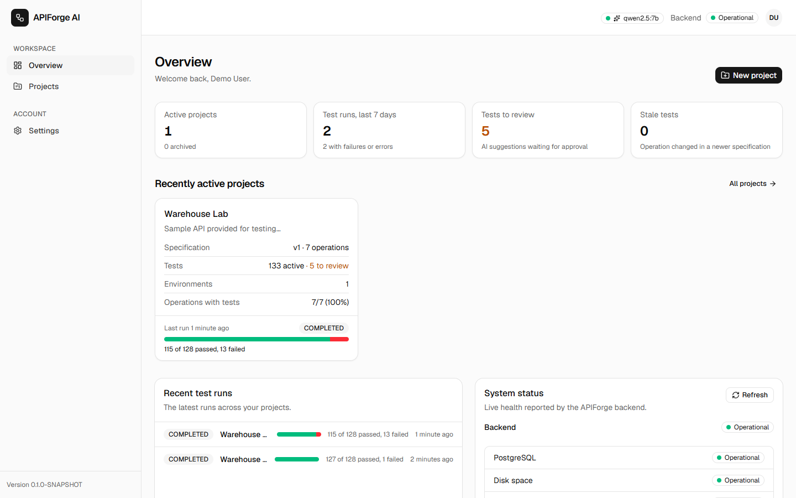

<sub>All screenshots are of the running application (Docker Compose stack, 2026-10-23), taken while executing the [demo workflow](docs/DEMO.md).</sub>

## Contents

[Features](#features) · [Screenshots](#screenshots) · [Architecture](#architecture) · [Data model](#data-model) · [Quick start](#quick-start-docker) · [Demo](#demo-workflow) · [Development setup](#development-setup) · [Configuration](#configuration) · [Using APIForge](#using-apiforge) · [AI with Ollama](#ai-with-ollama) · [API](#api) · [Testing](#testing) · [Security](#security) · [Limitations](#known-limitations) · [Troubleshooting](#troubleshooting) · [Documentation](#documentation) · [License](#license)

## Features

**Specifications**
- Import OpenAPI 3.0 and 3.1 documents (JSON or YAML, upload or paste) with a dry-run check; readable, located error messages; immutable versions, activation of older versions.
- Untrusted documents are handled safely: size, nesting and YAML alias limits; external `$ref`s are refused without any network request.
- Specification explorer: endpoints grouped by tag with search and method filters; parameters, request bodies and responses with an expandable schema view.

**Deterministic test generation**
- Valid requests built from schemas, examples and constraints, plus negative tests broken in exactly one place: missing and wrongly typed fields, enum, boundary, length and array-size violations, path, query and header parameters, content type, missing and invalid authentication.
- Every test states why it exists and what it expects; scenarios that cannot be generated safely are listed with the reason. Regeneration is idempotent and keeps your edits.
- Test workspace: per-endpoint lists, a project-wide finder (search, "needs review", AI-suggested, stale, disabled), editing, enable/disable, suites, bulk changes.

**Secure execution**
- Environments with base URL, timeout, redirect handling, an execution policy (read-only by default), authentication (bearer, basic, API key in header or query) and variables; secret variables are AES-256-GCM encrypted and write-only.
- Asynchronous, cancellable test runs (all tests, one endpoint, one suite or a selection) and a console for single requests.
- One guarded outbound client: private, loopback, link-local, multicast and cloud-metadata destinations are blocked, DNS answers are validated before connecting (rebinding-safe), every redirect is re-checked, and credentials are redacted from everything stored, returned or logged.

**Contract validation and reporting**
- Each response is checked for the expected and the documented status, media type, JSON syntax and the response schema (types, required fields, nested objects, arrays, enums, constraints, formats); every finding has a JSON path, expected and actual value.
- Honest outcomes: skipped or inconclusive checks are never counted as passed. Run history with filters, results by outcome, a body inspector that marks failing values, timing, and comparison with an earlier run.

**Coverage** — specification coverage (not code coverage): operations with and without tests, documented responses targeted and exercised, request constraints, schema branches and negative scenario kinds covered, each metric defined on the page; gaps, per-operation drill-down and changes between specification versions.

**Local AI (optional)** — through Ollama and Spring AI with strict structured output:
- *Suggest tests* for an endpoint: suggestions are validated like manual edits, deduplicated against existing tests and stored for review; they cannot run until accepted.
- *Explain failure*: a summary, observed facts checked against the recorded data, hypotheses with confidence, debugging steps and proposed changes — applied by nothing automatically.
- Without Ollama, every other feature works unchanged and the AI actions say why they are unavailable.

**Product** — dashboard and per-project overview built from stored numbers, settings (display name, password change that ends other sessions, account deletion), confirmation dialogs for irreversible actions, offline and backend-down banners, responsive layout, accessibility checked with axe.

**Operations** — production Docker images, a Compose stack with health-checked startup and persistent storage, optional HTTPS through Caddy, GitHub Actions for tests, images, end-to-end tests on the stack, dependency and secret scanning, and image releases.

## Screenshots

| | |
|---|---|
| 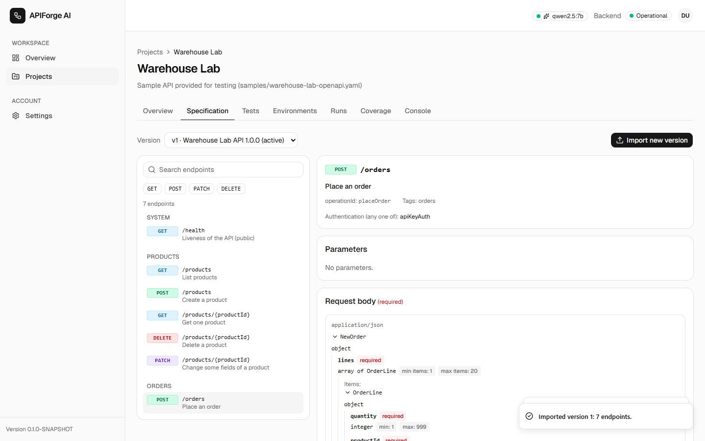 **Specification explorer** — a documented operation with its parameters, body and responses | 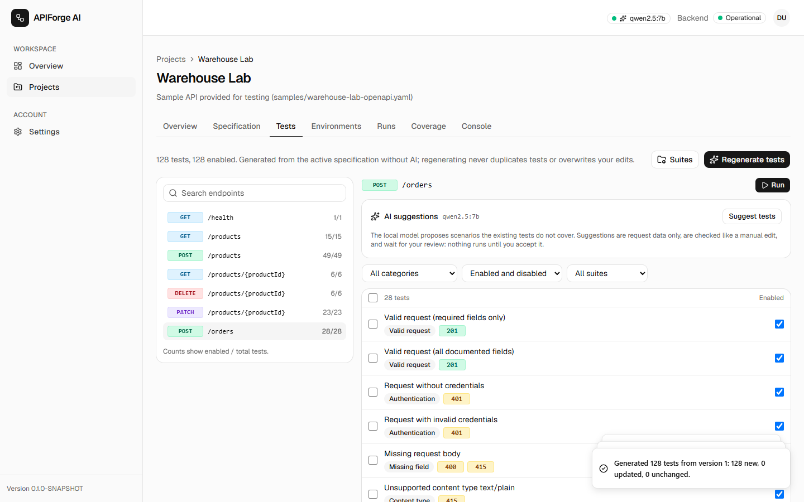 **Generated tests** — 128 tests for the sample's 7 operations, each with its reason and expectation |
| 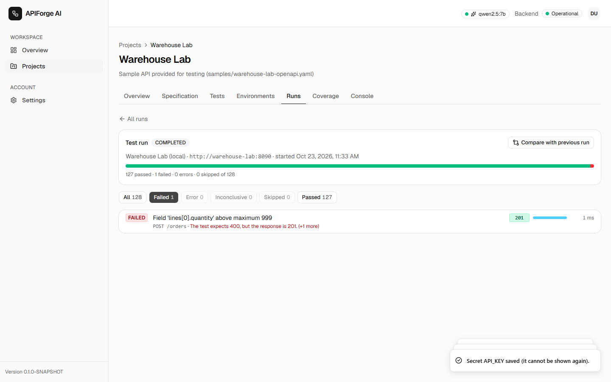 **Run results** filtered to failures | 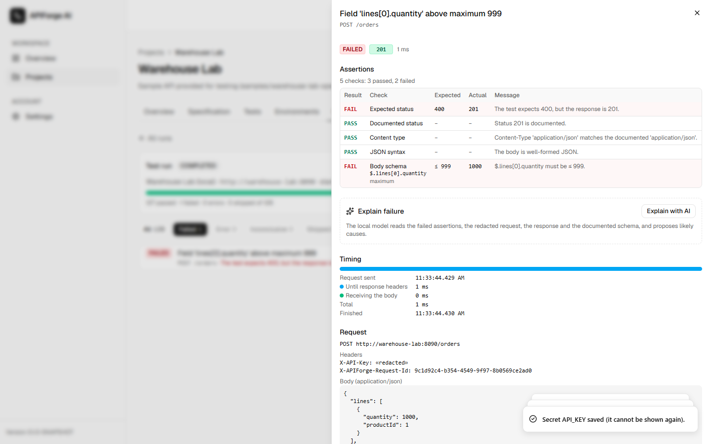 **Contract failure** — assertions with JSON path, expected and actual value; credentials redacted |
| 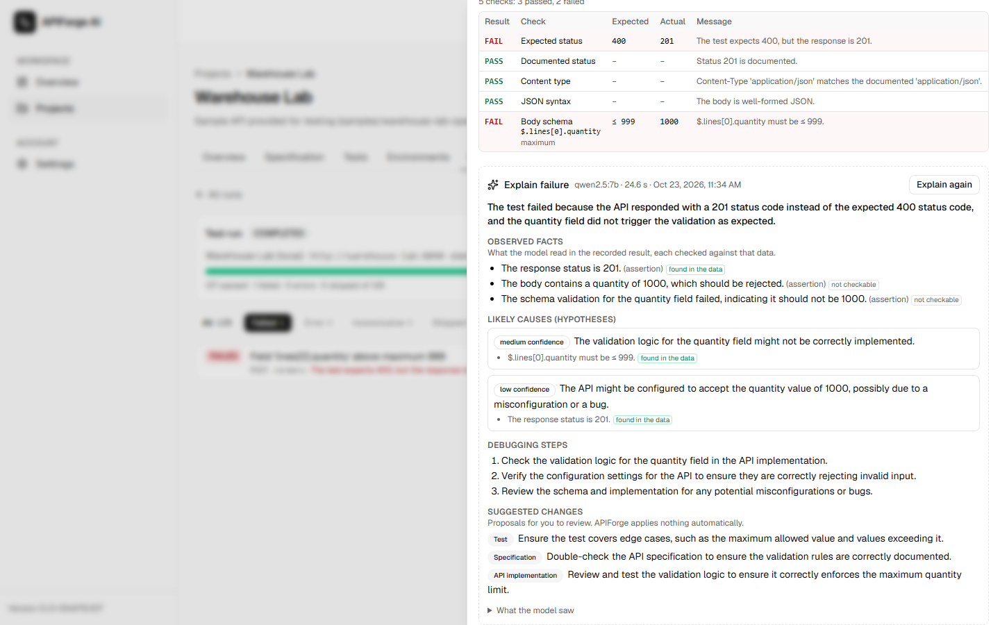 **AI explanation** — facts checked against the data, hypotheses kept apart | 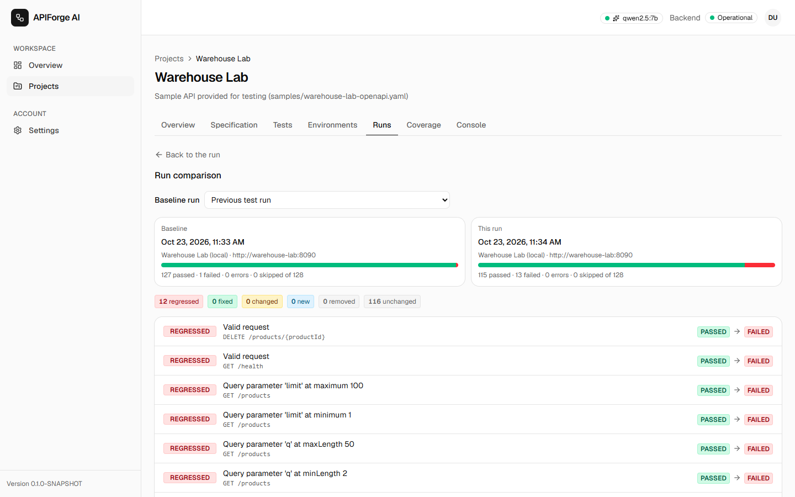 **Run comparison** — the regressions after the sample API started breaking its contract |
| 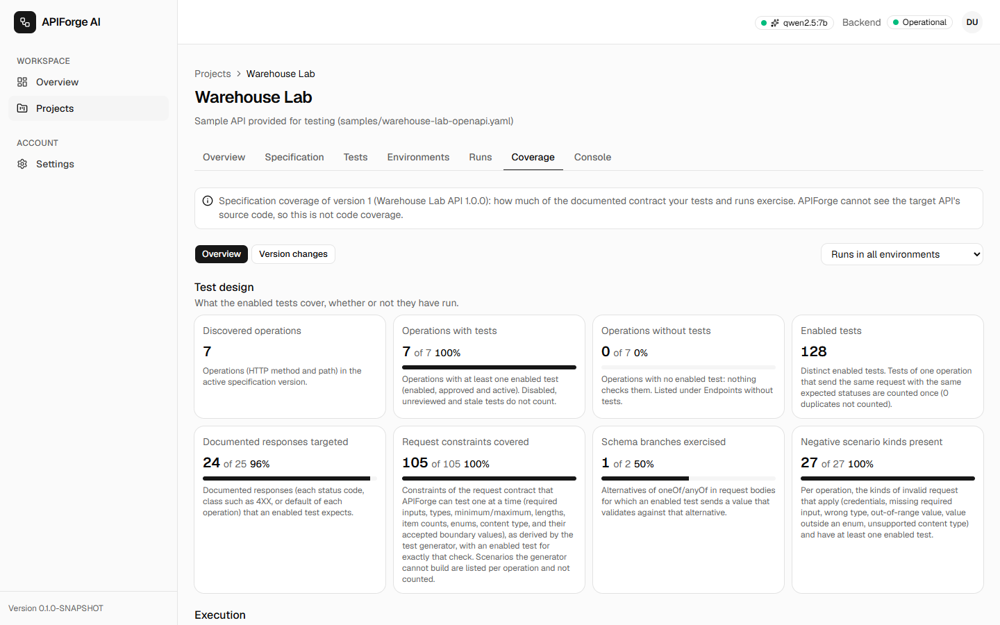 **Coverage** — specification coverage with definitions and gaps | 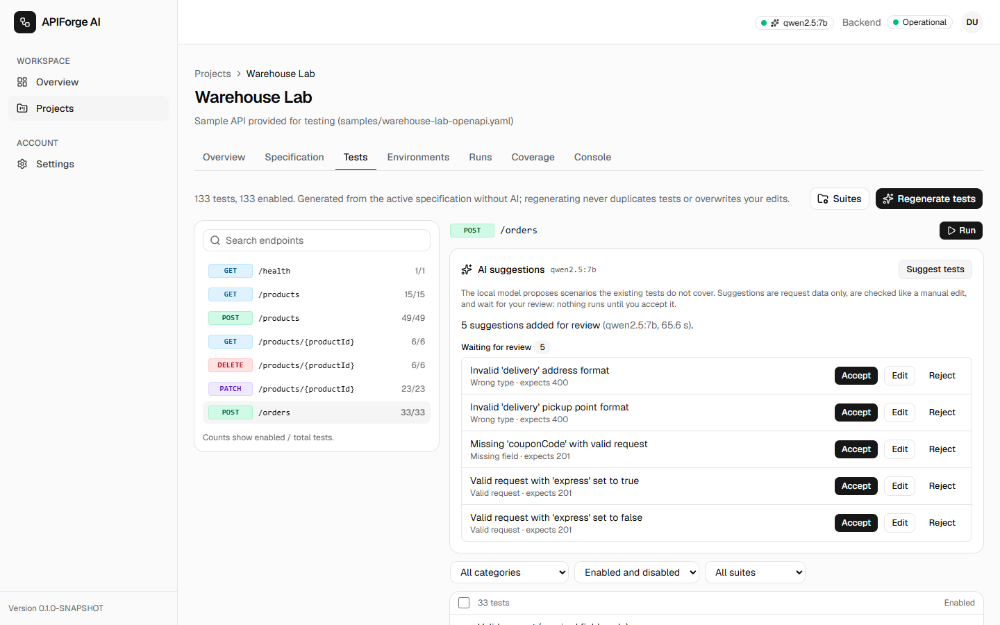 **AI suggestions** — stored for review, not runnable until accepted |

<p align="center">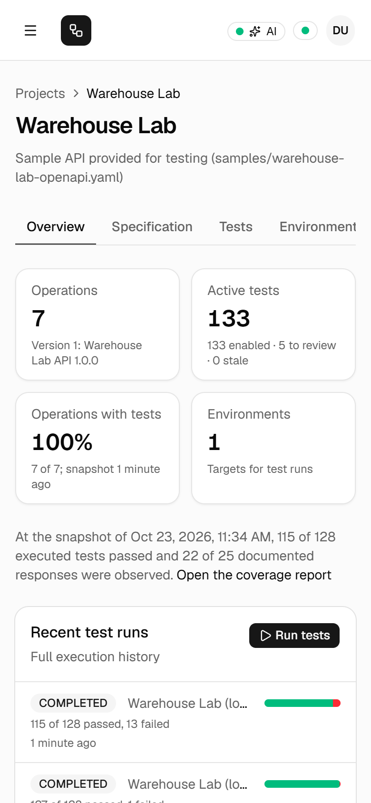</p>

## Architecture

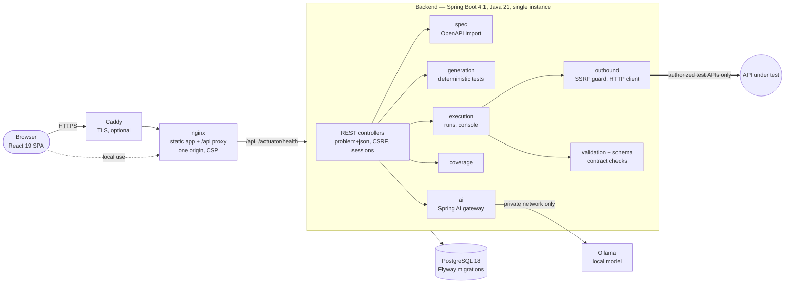

A modular monolith with package-by-feature modules whose boundaries are enforced by ArchUnit tests (e.g. only `outbound` opens HTTP connections, only `ai` uses Spring AI, only `secrets` uses cryptography). The browser talks to one origin; session and CSRF cookies stay first-party. Details: [docs/ARCHITECTURE.md](docs/ARCHITECTURE.md), decisions: [docs/DECISIONS.md](docs/DECISIONS.md).

| Layer | Technology |
|---|---|
| Backend | Java 21, Spring Boot 4.1 (Web MVC, Security, Data JPA, Validation, Actuator), Hibernate 7, Flyway, Swagger Parser, Apache HttpClient 5, Spring AI 2.0 (Ollama) |
| Frontend | React 19, TypeScript 6, Vite 8, Tailwind CSS 4, shadcn/ui (Radix), TanStack Query, React Router, zod, react-hook-form |
| Data | PostgreSQL 18 (jsonb, citext), 13 versioned migrations |
| Tests | JUnit 5, AssertJ, Testcontainers, ArchUnit; Vitest, Testing Library, MSW; Playwright |
| Delivery | Docker (non-root application containers with read-only filesystems), Docker Compose, Caddy, GitHub Actions, OSV-Scanner, gitleaks, Dependabot |

## Data model

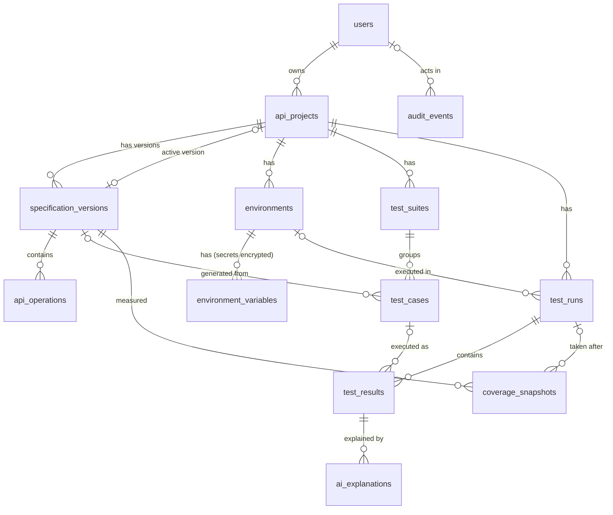

Every table belongs to a user's project and is deleted with it; runs and results keep snapshots (environment name, request, response) so history survives later edits. Columns, constraints and deletion rules: [docs/DATABASE_SCHEMA.md](docs/DATABASE_SCHEMA.md).

## Quick start (Docker)

Requirements: Docker with Compose v2. Ports 8080 (app) and 5432 (database, loopback only) free.

```bash
git clone https://github.com/alifsafiuddin/APIForge.git && cd APIForge
cp .env.example .env              # PowerShell: Copy-Item .env.example .env
```

Edit `.env`:

| Setting | Value |
|---|---|
| `APIFORGE_DB_PASSWORD` | any password of your choice |
| `APIFORGE_SECRETS_KEY` | `openssl rand -base64 32` (or any base64 of 32 random bytes) |
| `APIFORGE_COOKIE_SECURE` | `false` — only because the app runs on `http://localhost` |
| `APIFORGE_DEMO_TARGET_ENABLED` | `true` — lets the app test the bundled sample API (local use only) |
| `APIFORGE_STACK_OLLAMA_URL` | optional: `http://host.docker.internal:11434` if Ollama runs on your machine ([AI](#ai-with-ollama)) |

```bash
docker compose --profile demo up -d --build     # PostgreSQL, backend, frontend, sample API
docker compose ps                               # wait until postgres, backend and frontend are "healthy"
```

Open **http://localhost:8080**, choose **Create one** to register (password: 12–64 characters), and follow the [demo workflow](#demo-workflow). Stop with `docker compose --profile demo down` (data stays in the `pgdata` volume; `down -v` deletes it).

Profiles: `ai` runs Ollama in a container, `tls` adds HTTPS with Caddy for a server, `demo` adds the sample API. Production settings, backups, monitoring and hosting options: [docs/DEPLOYMENT.md](docs/DEPLOYMENT.md).

## Demo workflow

A safe, reproducible walkthrough against **Warehouse Lab**, a small sample API that ships with this repository ([`samples/warehouse-lab-openapi.yaml`](samples/warehouse-lab-openapi.yaml), [`samples/warehouse-lab-server.mjs`](samples/warehouse-lab-server.mjs)) and exists only to be tested. It runs locally, is the only destination the app is allowed to reach in this setup, and contains one deliberate contract violation — plus more on request — so there is something real to find:

1. Register and create a project.
2. Import `samples/warehouse-lab-openapi.yaml` (7 endpoints) and browse it.
3. Generate tests (128).
4. Create an environment for `http://warehouse-lab:8090` with the sample's demo API key as a secret variable.
5. Run all tests → 127 pass, 1 fails: the API accepts an order quantity of 1000 although the contract allows at most 999.
6. Open the failure: the status and the schema assertions with path, expected and actual value; optionally **Explain with AI**.
7. Make the sample break its contract on purpose (`APIFORGE_DEMO_VIOLATIONS=1`), run again (13 failures) and compare the runs.
8. Look at coverage; optionally let the AI suggest tests.

Step-by-step instructions with the exact values: [docs/DEMO.md](docs/DEMO.md).

## Development setup

Requirements: JDK 21, Node.js 24 LTS, Docker (for PostgreSQL and the backend's Testcontainers tests). Maven is not needed (Maven Wrapper).

```bash
cp .env.example .env                                  # set APIFORGE_DB_PASSWORD
docker compose up -d --wait postgres                  # database only, on 127.0.0.1:5432
cd backend && ./mvnw spring-boot:run                  # http://localhost:8081, dev profile (Windows: .\mvnw.cmd)
cd frontend && npm ci && npm run dev                  # http://localhost:5173, proxies /api to the backend
node samples/warehouse-lab-server.mjs                 # sample API on 127.0.0.1:8090 (trusted in the dev profile)
```

In this mode the sample API's base URL is `http://127.0.0.1:8090`. The `dev` profile uses a public development-only encryption key, so `APIFORGE_SECRETS_KEY` may stay empty; the `prod` profile refuses that key.

| Where | Command | Purpose |
|---|---|---|
| `backend/` | `./mvnw verify` | Compile (warnings are errors), unit and integration tests (Testcontainers), architecture rules, coverage gates |
| `frontend/` | `npm run check` | Lint (oxlint), type check, unit tests |
| `frontend/` | `npm run build` | Production build |
| `e2e/` | `npm ci && npx playwright test` | End-to-end journeys against the running app ([docs/TESTING.md](docs/TESTING.md)) |

## Configuration

All settings are environment variables; [.env.example](.env.example) documents every one with safe placeholders. The most important:

| Variable | Purpose |
|---|---|
| `APIFORGE_DB_PASSWORD` (+ `_NAME`, `_USER`, `_PORT`, `_URL`) | PostgreSQL connection |
| `APIFORGE_SECRETS_KEY` | AES-256-GCM key for secret variables — **required** in production, and must be backed up separately from the database |
| `APIFORGE_COOKIE_SECURE` | `Secure` cookies; `true` whenever the app is served over HTTPS |
| `APIFORGE_AUTH_REGISTRATION_ENABLED` | Allow self-registration |
| `APIFORGE_AI_ENABLED`, `OLLAMA_BASE_URL` / `APIFORGE_STACK_OLLAMA_URL`, `APIFORGE_AI_MODEL` | Local AI (optional) |
| `APIFORGE_DOMAIN`, `APIFORGE_PROXY_TRUSTED` | HTTPS with Caddy (`tls` profile) |
| `APIFORGE_DEMO_TARGET_ENABLED`, `APIFORGE_DEMO_VIOLATIONS` | Sample API as test target (`demo` profile, local only) |

The full reference with production values: [docs/DEPLOYMENT.md §3](docs/DEPLOYMENT.md#3-configuration-environment-variables).

## Using APIForge

**Import a specification.** In a project, open **Specification → Import specification**, upload a file or paste the text, use **Check** for a dry run, then **Import**. Each import creates an immutable version; the newest becomes active (older ones can be activated again). Multi-file specifications must be bundled into one document first (external references are refused for safety). Try [`samples/petstore3-openapi.yaml`](samples/) (the official Swagger Petstore 3, 19 endpoints) or the Warehouse Lab sample.

**Generate tests.** Open **Tests → Generate tests**. The report lists created, updated and unchanged tests and every scenario that was not generated, with the reason. Pick an endpoint to review its tests; open one to see why it exists, what it sends and what it expects; edit, disable or move it to a suite. Regenerating after a specification change never duplicates tests or overwrites your edits; tests of removed or changed operations become *stale*.

**Run tests and inspect contract failures.** Create an environment (**Environments → New environment**) for an API you are allowed to test — APIForge shows this notice on the first one — with its credentials as secret variables. Then **Run tests** (all, one endpoint, one suite or a selection) and follow the run. Filter results by outcome and open a failed result: each assertion shows the check, the JSON path, the expected and actual value and a message; the response body marks the failing values; timing and the redacted request are below. **Compare with previous run** lists regressions, fixes and changes.

**Coverage.** The **Coverage** tab shows which operations, documented responses, constraints and negative scenarios the tests cover and exercise, with a definition next to every number, the gaps, and a drill-down per operation.

## AI with Ollama

AI is optional. To use it:

1. Install Ollama (https://ollama.com, tested with 0.40.8) and pull a model: `ollama pull qwen2.5:7b` (default; needs about 8 GB RAM or a 6 GB GPU) or `ollama pull llama3.2:3b` (smaller machines, set `APIFORGE_AI_MODEL=llama3.2:3b`).
2. Point APIForge at it: from source, `OLLAMA_BASE_URL=http://localhost:11434` (the default); with Docker, `APIFORGE_STACK_OLLAMA_URL=http://host.docker.internal:11434` — or run Ollama in the stack with `docker compose --profile ai up -d` (pulls the model into a persistent volume; the image is about 3.4 GB).
3. The header chip shows the model and whether it is ready. Use **Suggest tests** on an endpoint in the Tests tab, and **Explain with AI** on a failed result.

Never expose Ollama's port to the internet: it has no authentication. What the model sees, how answers are validated, and hardware guidance: [docs/AI.md](docs/AI.md); measured quality and latency of both models: [docs/AI_EVALUATION.md](docs/AI_EVALUATION.md).

## API

A JSON REST API under `/api/v1` with session authentication, CSRF protection, `application/problem+json` errors with stable codes, and a request id on every response. Example — the result of the failing sample test:

```http
GET /api/v1/projects/{projectId}/runs/{runId}/results/{resultId}
```

```json
{
  "outcome": "FAILED",
  "checks": [
    { "name": "STATUS", "result": "FAIL", "expected": "400", "actual": "201", "message": "The test expects 400, but the response is 201." },
    { "name": "BODY_SCHEMA", "result": "FAIL", "path": "$.lines[0].quantity", "keyword": "maximum", "expected": "≤ 999", "actual": "1000", "message": "$.lines[0].quantity must be ≤ 999." }
  ],
  "request": { "method": "POST", "url": "http://warehouse-lab:8090/orders", "headers": { "X-API-Key": "«redacted»" } }
}
```

More real requests and responses (registration with CSRF, import, generation, runs, coverage, errors): [docs/API_EXAMPLES.md](docs/API_EXAMPLES.md). Full reference: [docs/API_DESIGN.md](docs/API_DESIGN.md).

## Testing

| Suite | Size | Result (clean checkout, 2026-10-23) |
|---|---|---|
| Backend — JUnit 5, Testcontainers PostgreSQL 18, real HTTP, ArchUnit | 868 tests | all pass; 94.0% line and 80.1% branch coverage |
| Frontend — Vitest, Testing Library, MSW | 125 tests | all pass |
| End-to-end — Playwright against the running stack | 12 journeys | all pass (AI journeys in their matching mode: with and without Ollama) |
| Stack — images, startup order, migrations, exposure, persistence | 36 checks | all pass |

How the tests are organized, what each suite proves, and the quality gates: [docs/TESTING.md](docs/TESTING.md). The latest full quality-assurance pass (commands, outcomes, defects found and fixed): [docs/QA_REPORT.md](docs/QA_REPORT.md).

## Security

- **Accounts**: bcrypt password hashes, server-side sessions (`HttpOnly`, `SameSite`), CSRF tokens, lockout after repeated failures, per-IP rate limits, absolute session lifetime, password change ends other sessions, audit trail.
- **Authorization**: every project-scoped request checks ownership; another user's resource answers exactly like a missing one.
- **Outbound requests (SSRF)**: one guarded client; private, loopback, link-local, multicast and metadata addresses blocked, including encoded forms and DNS rebinding; redirects re-checked; time and size limits; read-only execution by default.
- **Secrets**: encrypted at rest (AES-256-GCM), write-only through the API, redacted from results, logs and AI prompts — verified by tests that capture the logs.
- **Untrusted input**: OpenAPI documents parsed with limits and no network access; strict request validation; no stack traces in responses.
- **AI**: the model only reads redacted data, its output is validated against strict schemas, suggestions need review before they can run, and nothing is applied automatically.
- **Deployment**: non-root, read-only containers without secrets; database and model server never published; strict Content-Security-Policy; dependency (OSV-Scanner) and secret (gitleaks) scanning in CI.

Threat model and every control with its test: [docs/SECURITY.md](docs/SECURITY.md).

## Known limitations

- **Single backend instance**: sessions and rate limits are kept in memory; a restart signs users out. Horizontal scaling would need shared session and rate-limit storage.
- **HTTP/JSON REST only**: OpenAPI 3.0/3.1; no Swagger 2.0, GraphQL, gRPC or WebSockets; multi-file specifications must be bundled; at most 500 tests per run.
- **Specification coverage, not code coverage**: it measures what the tests exercise of the documented contract.
- **AI quality depends on the model and hardware**: suggestions need review (enforced). Measured with `qwen2.5:7b` on a 6 GB laptop GPU: explanations median 16 s (max 26 s), suggestions median 33 s; CPU-only inference is much slower.
- **No e-mail features**: no password reset by e-mail; e-mail addresses cannot be changed.
- **Verified on one machine**: Windows 11 with Docker Desktop; browser tests in Chromium-based Microsoft Edge. GitHub Actions workflows are linted but their first run happens on GitHub.
- **Hosting**: no free tier reviewed offers a dependable database plus the memory for local AI ([DEPLOYMENT.md §11](docs/DEPLOYMENT.md#11-free-tier-limitations-checked-2026-10-23)).

## Troubleshooting

| Problem | Fix |
|---|---|
| `docker compose up` says `APIFORGE_DB_PASSWORD` is missing | Copy `.env.example` to `.env` and set it |
| Backend container keeps restarting; its log says `APIFORGE_SECRETS_KEY` (`apiforge.secrets.key`) is invalid | Set `APIFORGE_SECRETS_KEY` to base64 of 32 random bytes (`openssl rand -base64 32`) |
| Sign-in appears to succeed but you stay signed out | Browsers refuse `Secure` cookies over plain HTTP (some allow them on `localhost` only). Without HTTPS set `APIFORGE_COOKIE_SECURE=false`; with HTTPS keep `true` |
| An environment's base URL is refused as private | Intended: only public addresses are allowed. Locally, use the `demo` profile's `http://warehouse-lab:8090` (with `APIFORGE_DEMO_TARGET_ENABLED=true`) or, from source, `http://127.0.0.1:8090` |
| AI shows "Unavailable" in the Docker stack | Ollama runs on your machine: set `APIFORGE_STACK_OLLAMA_URL=http://host.docker.internal:11434` and recreate the backend (`docker compose up -d backend`). On Linux, Ollama must listen on an address the container can reach |
| AI shows "Model missing" | `ollama pull <APIFORGE_AI_MODEL>` |
| "Invalid e-mail or password" although the password is right | Five failed attempts lock sign-in for 15 minutes; wait |
| "External reference … is not supported" on import | Bundle the specification into one file (e.g. `npx @redocly/cli bundle openapi.yaml -o bundled.yaml`) |
| Port 8080 or 5432 in use | Change `APIFORGE_HTTP_PORT` or `APIFORGE_DB_PORT` in `.env` |
| Signed out after restarting the backend | Expected: sessions are in memory |
| Backend tests fail with "Could not find a valid Docker environment" | Start Docker; Testcontainers needs it |

## Documentation

| Document | Contents |
|---|---|
| [DEMO.md](docs/DEMO.md) | The demo workflow, step by step |
| [ARCHITECTURE.md](docs/ARCHITECTURE.md) | System context, modules, flows, frontend routes |
| [DATABASE_SCHEMA.md](docs/DATABASE_SCHEMA.md) | Full ER diagram, tables, constraints, migrations |
| [API_DESIGN.md](docs/API_DESIGN.md) / [API_EXAMPLES.md](docs/API_EXAMPLES.md) | Endpoint reference / real requests and responses |
| [SECURITY.md](docs/SECURITY.md) | Threat model and controls |
| [AI.md](docs/AI.md) / [AI_EVALUATION.md](docs/AI_EVALUATION.md) | Ollama setup and AI design / measured model quality |
| [TESTING.md](docs/TESTING.md) / [QA_REPORT.md](docs/QA_REPORT.md) | Test strategy and suites / quality-assurance results |
| [DEPLOYMENT.md](docs/DEPLOYMENT.md) | Docker, configuration, migrations, backups, CI/CD, hosting, monitoring |
| [DECISIONS.md](docs/DECISIONS.md) | Architecture decision records and dependency matrix |
| [PROJECT_STATUS.md](docs/PROJECT_STATUS.md) | Release status, verification results, limitations |
| [PORTFOLIO.md](docs/PORTFOLIO.md) | Project summary and verified highlights |

## License

[MIT](LICENSE) © 2026 Alif Safiuddin. Third-party components and their licenses (including the OFL-licensed Geist font that ships with the frontend): [THIRD_PARTY_NOTICES.md](THIRD_PARTY_NOTICES.md).

Use APIForge only against APIs you own or are explicitly authorized to test.
