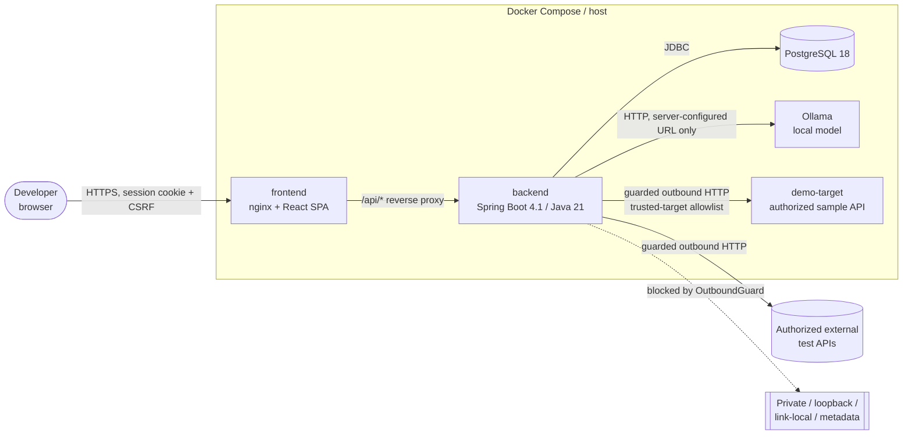
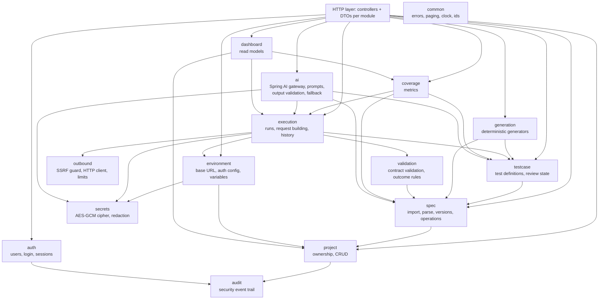
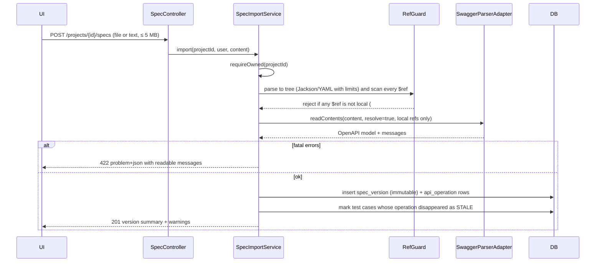
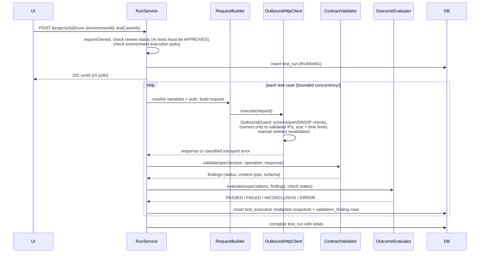

# Architecture

> Status: **Phase 2**. Implemented: backend foundation (`common`, `config`, `system`), the full persistence model (all entities and migrations V1–V6), authentication (`auth`), auditing (`audit`), projects (`project`), read-only execution history (`execution`), OpenAPI import and exploration (`spec`), ArchUnit-enforced layering, and the frontend with sign-in, registration, project management and the specification explorer. Everything else here is design. See [PROJECT_STATUS.md](PROJECT_STATUS.md).

## 1. Goals and non-goals

**Goals**

- Import OpenAPI 3.x specifications and make them explorable.
- Generate deterministic, explainable baseline tests from schemas.
- Execute real HTTP requests against **authorized** targets with strong outbound-request (SSRF) controls.
- Validate responses against the documented contract and report precise, explainable findings.
- Track history and endpoint/response coverage transparently.
- Use a **local** LLM (Ollama via Spring AI) for test suggestions and failure explanations, never as a dependency of deterministic testing.

**Non-goals (explicitly out of scope)**

- Code coverage of the target API (we only measure *specification* coverage).
- Load/performance testing, fuzzing, or security scanning of third-party systems.
- Scripted tests (no user- or AI-supplied code is ever executed; tests are declarative data).
- Multi-tenant organizations/teams (single-owner projects in v1).
- Swagger 2.0 import (OpenAPI 3.0.x and 3.1.x only; see [DECISIONS.md](DECISIONS.md) ADR-021).

## 2. System context



- The browser talks **only** to the frontend origin. nginx serves the SPA and reverse-proxies `/api/**` to the backend, so the session cookie is same-origin and no CORS is needed in deployed setups.
- The backend is the **only** component that makes outbound requests, and every user-influenced outbound request passes through the `outbound` module.
- The Ollama URL is server configuration, never user input.

## 3. Backend: modular monolith

A single Spring Boot application, **package-by-feature**, with layering enforced by ArchUnit tests. A monolith is deliberate: one deployable, one database, no message broker. Async test runs use a bounded in-process executor (ADR-014).

### 3.1 Module map



Rules (enforced by ArchUnit from Phase 2, when the first layered modules exist):

1. Controllers depend only on services and DTOs, never on repositories or entities.
2. Entities never leave the service layer; controllers return DTOs (records).
3. Only `outbound` may construct HTTP clients for user-supplied destinations.
4. Only `ai` may depend on Spring AI types.
5. Only `spec` and `validation` may depend on swagger-parser / openapi-request-validator types.
6. No cyclic dependencies between modules.

### 3.2 Layers inside a module

```
<module>/
  web/          @RestController classes, request/response DTOs (records), DTO mappers
  service/      business logic, transactions, authorization checks
  domain/       JPA entities, enums, value objects
  repository/   Spring Data JPA repositories
  internal/     module-private helpers (adapters for external libraries)
```

Authorization is enforced in services (`ProjectAccessService.requireOwned(projectId, userId)`) rather than in controllers, so it applies regardless of entry point.

### 3.3 Key flows

#### Spec import



No network or filesystem access happens during import (ADR-005, [SECURITY.md](SECURITY.md) §5).

#### Test execution



#### AI assistance (never on the critical path)

```mermaid
flowchart LR
    ctx[Build context<br/>from DB] --> san[ContextSanitizer<br/>redact secrets, truncate,<br/>assign citation ids]
    san --> call[Spring AI ChatClient<br/>Ollama, JSON-schema output,<br/>timeout + concurrency cap]
    call -->|ok| val[AiOutputValidator<br/>schema, enums, sizes,<br/>citations must exist,<br/>operation must exist]
    call -->|offline/timeout| fb[Deterministic fallback]
    val -->|valid| out[Result labelled AI,<br/>hypotheses labelled]
    val -->|invalid| fb
    out --> store[(ai_interaction)]
    fb --> store
```

- **Suggestions** become `test_case` rows with `origin=AI_SUGGESTED`, `review_status=PENDING_REVIEW`. They cannot be executed until a user approves them, and they are constrained to declarative request data for an existing operation. The host and base URL always come from the environment.
- **Failure explanations** are attached to a `test_execution`. If Ollama is offline or the output is invalid, the user gets a deterministic summary built from the validation findings, labelled as such.

## 4. How generation, validation and AI interact

| Concern | Deterministic engine | AI |
|---|---|---|
| Baseline tests | Generated from schema rules; reproducible (same spec gives the same tests) | — |
| Extra test ideas | — | Suggested; stored as pending; human review required; validated against the operation's schema shape |
| Pass/fail verdict | **Only** `OutcomeEvaluator`, from expectations + validation findings | Never decides verdicts |
| Failure explanation | Deterministic finding summary (always available) | Optional richer explanation, hypotheses labelled, citations checked |

An AI outage cannot change a test verdict or block generation, execution, validation or coverage.

## 5. Outcome semantics (no false passes)

Each execution runs a list of **checks**. Each check ends in one of `PASS`, `FAIL`, `NOT_APPLICABLE` (with reason) or `INCONCLUSIVE` (with reason).

| Condition | Execution outcome |
|---|---|
| Transport error (timeout, DNS, refused, blocked by policy, too large) | `ERROR` |
| Any check `FAIL` | `FAILED` |
| No `FAIL`, but any check `INCONCLUSIVE` (e.g. schema used an unsupported keyword, body not parseable as declared type, response truncated by size cap) | `INCONCLUSIVE` |
| All checks `PASS` or `NOT_APPLICABLE` | `PASSED` |
| Not executed (policy, not approved, cancelled) | `SKIPPED` (with reason) |

`INCONCLUSIVE` and `SKIPPED` are never counted as passed in any UI or metric.

## 6. Frontend

React SPA (Vite, TypeScript 6.0, Tailwind CSS 4, shadcn/ui on Radix primitives, React Router in data mode, TanStack Query, react-hook-form + zod, Recharts).

### 6.1 Routes and navigation

| Route | Page | Notes |
|---|---|---|
| `/login`, `/register` | Auth ✅ | Registration can be disabled by config; `?next=` is restricted to in-app paths |
| `/` | Overview dashboard | ✅ recent projects + system status; later recent runs, pass/fail trend, coverage summary |
| `/projects` | API projects ✅ | List (search, sort, active/archived, paging), create, edit, archive/restore, delete (typed confirmation) |
| `/projects/:projectId` | Project overview | Active spec, environments, last run, coverage tile |
| `/projects/:projectId/spec` | Specification explorer ✅ | Version selector (activate older versions), searchable endpoint index grouped by tag with method filters, version overview (servers, security schemes, tags, import findings, original download), import dialog (upload or paste, dry-run check) |
| `/projects/:projectId/spec/operations/:operationId` | Endpoint detail ✅ | Parameters by location, request body and responses per media type with an expandable schema viewer (references, enums, nullable, required, constraints, recursion), effective security, import warnings; later: tests for this endpoint and ad hoc send |
| `/projects/:projectId/tests` | Test generation workspace ✅ | Generate and regenerate deterministic tests, with a report (created, updated, unchanged, kept edits, archived, skipped with reasons). An endpoint index shows enabled/total counts; each endpoint lists its tests with category, state and suite filters and bulk enable, disable or move. The test panel shows why the test exists, its expected outcome and response checks, the request and its provenance, with enable, move, review and edit. Also a suites dialog and "not generated" reasons per endpoint. Later: AI suggestions review queue |
| `/projects/:projectId/runs` | Execution history | Filterable list of runs |
| `/projects/:projectId/runs/:runId` | Test execution results + contract validation report | Per-test outcomes, findings grouped by rule/severity |
| `/projects/:projectId/executions/:executionId` | Execution detail + AI failure assistant | Request/response (redacted), findings, explain panel |
| `/projects/:projectId/coverage` | Coverage report | Metrics with definitions, untested endpoints/responses, missing negatives |
| `/projects/:projectId/environments` | Environment configuration | Base URL, auth, variables (secrets write-only), execution policy |
| `/settings` | Settings | Profile, password, AI status/model info |

Layout: left sidebar (global: Overview, Projects, Settings; project-scoped section when inside a project), top bar with project switcher and user menu; collapses to a drawer below the `md` breakpoint.

### 6.2 Frontend structure

```
frontend/src/
  app/            router, providers (QueryClient, theme), layout shell
  api/            typed fetch client (CSRF, problem+json parsing), query keys
  features/       one folder per feature (auth, projects, spec, tests, runs, coverage, environments, ai, settings)
    <feature>/    components/, hooks/ (TanStack Query), schemas.ts (zod), types.ts, pages
  components/ui/  shadcn/ui components (copied, owned)
  components/     shared composites (DataTable, EmptyState, ErrorState, ConfirmDialog, JsonViewer, StatusBadge)
  lib/            utils, formatting
  test/           MSW handlers, test utils
```

Untrusted content (response bodies, spec descriptions, AI text) is always rendered as **text**, never as HTML. There is no `dangerouslySetInnerHTML`, and Markdown descriptions are rendered with raw HTML disabled.

## 7. Repository layout

```
/
├── README.md
├── docker-compose.yml           # postgres, ollama, backend, frontend, demo-target
├── .env.example                 # documented variables, no real secrets
├── .github/workflows/ci.yml
├── docs/                        # this documentation
├── backend/                     # Maven (wrapper), Spring Boot app
│   ├── pom.xml, mvnw, mvnw.cmd
│   └── src/{main,test}/...
│       main/java/com/apiforge/{auth,audit,project,spec,environment,secrets,testcase,
│                               generation,execution,outbound,validation,coverage,
│                               ai,dashboard,common,config}
│       main/resources/db/migration/V*__*.sql
├── frontend/                    # Vite React app
│   ├── package.json, package-lock.json
│   ├── Dockerfile, nginx.conf
│   └── src/...
├── demo-target/                 # small Spring Boot API + its openapi.yaml (authorized test target)
└── e2e/                         # Playwright tests against the compose stack
```

## 8. Cross-cutting concerns

- **Configuration**: `@ConfigurationProperties` records under the `apiforge.*` prefix, validated at startup with `@Validated`. Profiles: `dev`, `test`, `prod`. Secrets only via environment variables.
- **Logging**: Spring Boot native structured logging (`logging.structured.format.console=ecs`) in `prod`, human-readable in `dev`. A request-id MDC filter is applied. Log messages never include header values, bodies, or variable values (enforced by the redaction module and tests).
- **Errors**: RFC 9457 `application/problem+json` via `ProblemDetail`, with a stable `code` and optional `errors[]`. Stack traces are never returned.
- **Health**: Actuator `health` (liveness/readiness groups) and `info` are exposed. Ollama has its own health indicator but is **excluded from readiness**, so an AI outage does not mark the app down.
- **Concurrency**: virtual threads enabled. Run execution uses a bounded executor with per-user concurrency caps.
- **Time & IDs**: UUIDv7-style random UUIDs generated in the app, `timestamptz` everywhere, and an injectable `Clock` for tests.
