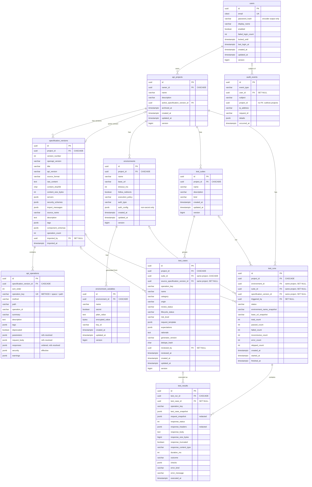

# Database Schema

> Status: **implemented through Phase 3** (migrations V1–V7). The Flyway migrations in
> `backend/src/main/resources/db/migration` are the source of truth; this document explains them.
> The table for validation findings is added with contract validation.

- PostgreSQL 18. Schema changes go through **Flyway only**; Hibernate runs with `ddl-auto=validate`, so every build checks that entities match the migrated schema.
- Primary keys are `uuid`, generated in the application as **UUIDv7** (time-ordered, index-friendly). Timestamps are `timestamptz` and come from the injectable `Clock`.
- Flexible, display-oriented structures (request templates, snapshots, parsed spec fragments) are `jsonb`. Anything filtered, joined or aggregated is a real column with a check constraint.
- Integrity rules live **in the database**, not only in Java, so they hold even if application code is bypassed (verified by `SchemaIntegrationTest`).

## 1. Entity relationship diagram

## 2. Migrations

| Migration | Content |
|---|---|
| `V1__enable_extensions.sql` | `citext` |
| `V2__users_and_audit_events.sql` | `users`, `audit_events` (+ append-only trigger) |
| `V3__projects_and_specification_versions.sql` | `api_projects`, `specification_versions` (+ immutability trigger), composite FK for the active version |
| `V4__environments.sql` | `environments`, `environment_variables` |
| `V5__test_suites_and_test_cases.sql` | `test_suites`, `test_cases` |
| `V6__test_runs_and_test_results.sql` | `test_runs`, `test_results` (+ immutability trigger) |
| `V7__api_operations_and_spec_metadata.sql` | `api_operations` (+ immutability trigger); `specification_versions` gains `source_name`, `description`, `tags`, `component_schemas`, `operation_count`; audit types `SPECIFICATION_IMPORTED`, `SPECIFICATION_ACTIVATED` |

Applied migrations are never edited; corrections are new migrations. Verified on an empty database (Testcontainers) and incrementally on the development database (V1 → V6 in Phase 2, V6 → V7 in Phase 3).

## 3. Integrity rules enforced by the database

| Rule | Mechanism |
|---|---|
| A raw password can never be stored | `ck_users_password_hash_encoded`: value must look like encoder output (`{bcrypt}…`) |
| E-mail unique regardless of case | `citext` + `uq_users_email` |
| A secret variable exists only as ciphertext | `ck_environment_variables_storage`: `secret ⇒ plain_value IS NULL AND encrypted_value/key_id NOT NULL`; plain variables never use the encrypted columns |
| Child rows cannot point into another project | Composite foreign keys `(child_id, project_id) → parent(id, project_id)` for a test case's suite and source spec, a run's environment/suite/spec, and a project's active spec version |
| AI-suggested tests need an explicit human review to be approved | `ck_test_cases_ai_review`: `origin = AI_SUGGESTED AND review_status = APPROVED ⇒ reviewed_at NOT NULL` |
| A result never claims PASSED without a real response | `ck_test_results_passed_has_response`; an ERROR always has an `error_kind` |
| Run counters are consistent | Non-negative, and outcome counts never exceed `total_count`; `created_at ≤ started_at ≤ finished_at` |
| History cannot be rewritten | Triggers reject `UPDATE` on `test_results`, `specification_versions`, `api_operations` and `audit_events`, except the `SET NULL` caused by deleting a referenced user or test case |
| Enumerations are closed | `CHECK (… IN (…))` on every status/kind/category column, mirrored by Java enums |
| Names unique where it matters | Active project names per owner (case-insensitive, partial index on `archived_at IS NULL`); environment and suite names per project |
| Regeneration is idempotent | Partial unique index `(project_id, dedupe_hash)` for non-archived test cases |

## 4. Deletion rules

| Deleted | Effect |
|---|---|
| User | Their projects and everything inside them are deleted (cascade). Audit events keep the row with `user_id = NULL`. Tests reviewed or runs triggered by the user elsewhere keep `NULL` references |
| Project | Cascades to specification versions, environments (and variables), suites, test cases, runs and results |
| Test suite | Cascades to its test cases; runs that referenced the suite keep `suite_id = NULL` |
| Test case | Results keep their snapshot with `test_case_id = NULL` (history survives) |
| Environment | Runs keep the environment name and base URL snapshots with `environment_id = NULL` |
| Specification version | Not deleted on its own (immutable history); removed only with its project |

## 5. Indexes

Beyond primary keys and the unique constraints above: `api_projects(owner_id, updated_at DESC)`, `audit_events(user_id, occurred_at DESC)`, `audit_events(event_type, occurred_at DESC)`, `test_cases(project_id, operation_key)`, `test_cases(suite_id)`, `test_cases(project_id, review_status)`, `test_runs(project_id, created_at DESC)`, `test_runs(project_id, status)`, `test_results(test_run_id, executed_at)`, `test_results(test_case_id)`, `test_results(operation_key, outcome)`.

## 6. Notable decisions

- **Coverage snapshots are not stored** (the brief made them optional). Coverage is computed from `test_cases` and `test_results`, which already persist (ADR-013); a snapshot table can be added if it becomes slow.
- **Audit events are stored** for security-relevant actions: `USER_REGISTERED`, `LOGIN_SUCCEEDED`, `LOGIN_FAILED`, `ACCOUNT_LOCKED`, `LOGOUT`, `PROJECT_CREATED`, `PROJECT_DELETED`, `CROSS_USER_ACCESS_DENIED`. `subject` holds the e-mail used in a failed sign-in (so attacks on unknown accounts are visible); logs only ever contain user ids.
- **Entities reference each other by id** (no JPA associations). Every lookup goes through an owner- or project-scoped repository method, which keeps authorization explicit and avoids lazy-loading surprises with `open-in-view=false`.
- `test_runs` has no `version` column: runs are written by a single executor; results are append-only.
- `api_operations` stores one row per (method, path) of a version. `operation_key` (`GET /pets/{petId}`, checked by `ck_api_operations_key`) is the stable identity that links test cases and results across versions; re-importing never edits old rows, and test cases whose key disappears become `STALE`.
- `validation_findings` arrives with contract validation.
