# Database Schema

> Status: **Phase 0 design**. Migrations do not exist yet. Flyway migrations (`backend/src/main/resources/db/migration`) will be the source of truth once created, and this document will be updated to match them.

- Database: PostgreSQL 18. Schema changes go through **Flyway only**; `spring.jpa.hibernate.ddl-auto=validate`.
- Primary keys are `uuid`, generated by the application. Timestamps are `timestamptz`.
- Flexible, display-oriented structures (parsed parameter lists, request templates) are stored as `jsonb`. Anything that is filtered, joined or aggregated is stored as a real column.
- History is **append-only**. Executions store snapshots, so later edits to tests, environments or specs never rewrite past results.

## 1. Entity relationship diagram

```mermaid
erDiagram
    app_user ||--o{ project : owns
    project ||--o{ spec_version : "has versions"
    project |o--o| spec_version : "active version"
    spec_version ||--o{ api_operation : contains
    project ||--o{ environment : has
    environment ||--o{ environment_variable : has
    project ||--o{ test_case : has
    spec_version ||--o{ test_case : "generated from"
    project ||--o{ test_run : has
    environment ||--o{ test_run : "executed in"
    spec_version ||--o{ test_run : "validated against"
    test_run ||--o{ test_execution : contains
    test_case |o--o{ test_execution : "executed as"
    test_execution ||--o{ validation_finding : produces
    project ||--o{ ai_interaction : has
    test_execution |o--o{ ai_interaction : "explained by"

    app_user {
        uuid id PK
        citext email UK
        varchar password_hash
        varchar display_name
        boolean enabled
        int failed_login_count
        timestamptz locked_until
        timestamptz created_at
    }
    project {
        uuid id PK
        uuid owner_id FK
        varchar name
        text description
        uuid active_spec_version_id FK
        timestamptz archived_at
        timestamptz created_at
        timestamptz updated_at
        bigint version
    }
    spec_version {
        uuid id PK
        uuid project_id FK
        int version_number
        varchar openapi_version
        varchar title
        varchar api_version
        varchar source_format
        text raw_content
        char content_sha256
        jsonb servers
        jsonb security_schemes
        jsonb import_messages
        uuid imported_by FK
        timestamptz imported_at
    }
    api_operation {
        uuid id PK
        uuid spec_version_id FK
        varchar operation_key
        varchar method
        varchar path
        varchar operation_id
        varchar summary
        text description
        jsonb tags
        boolean deprecated
        jsonb security
        jsonb parameters
        jsonb request_body
        jsonb responses
    }
    environment {
        uuid id PK
        uuid project_id FK
        varchar name
        varchar base_url
        int timeout_ms
        boolean follow_redirects
        varchar execution_policy
        varchar auth_type
        jsonb auth_config
        timestamptz created_at
        timestamptz updated_at
        bigint version
    }
    environment_variable {
        uuid id PK
        uuid environment_id FK
        varchar name
        boolean secret
        text plain_value
        bytea encrypted_value
        varchar key_id
        timestamptz updated_at
    }
    test_case {
        uuid id PK
        uuid project_id FK
        uuid source_spec_version_id FK
        varchar operation_key
        varchar name
        varchar category
        varchar origin
        varchar review_status
        varchar lifecycle_status
        varchar risk_level
        jsonb request_template
        jsonb expectations
        text rationale
        varchar generator_version
        char dedupe_hash
        uuid reviewed_by FK
        timestamptz reviewed_at
        timestamptz created_at
        timestamptz updated_at
        bigint version
    }
    test_run {
        uuid id PK
        uuid project_id FK
        uuid environment_id FK
        uuid spec_version_id FK
        uuid triggered_by FK
        varchar status
        varchar environment_name_snapshot
        varchar base_url_snapshot
        int total_count
        int passed_count
        int failed_count
        int inconclusive_count
        int error_count
        int skipped_count
        timestamptz started_at
        timestamptz finished_at
    }
    test_execution {
        uuid id PK
        uuid test_run_id FK
        uuid test_case_id FK
        varchar operation_key
        jsonb test_case_snapshot
        jsonb request_snapshot
        int response_status
        jsonb response_headers
        text response_body
        bigint response_size_bytes
        boolean response_truncated
        varchar response_content_type
        int duration_ms
        varchar outcome
        jsonb checks
        varchar error_kind
        text error_message
        timestamptz executed_at
    }
    validation_finding {
        uuid id PK
        uuid test_execution_id FK
        varchar rule
        varchar severity
        varchar json_path
        text expected
        text actual
        text message
        varchar spec_pointer
    }
    ai_interaction {
        uuid id PK
        uuid project_id FK
        uuid user_id FK
        uuid test_execution_id FK
        varchar kind
        varchar operation_key
        varchar model
        varchar status
        jsonb result
        text failure_reason
        int latency_ms
        char context_sha256
        timestamptz created_at
    }
```

## 2. Tables and rules

### app_user

- `email` uses `citext` (case-insensitive unique), so the `citext` extension is enabled in `V1`.
- `password_hash` is produced by Spring Security's `DelegatingPasswordEncoder` (bcrypt, `{bcrypt}` prefix), so the algorithm can be upgraded without a schema change.
- `failed_login_count` and `locked_until` support temporary lockout after repeated failures ([SECURITY.md](SECURITY.md) §3).

### project

- `owner_id` → `app_user.id` `ON DELETE CASCADE`. Every child table is reached through the project, and authorization checks ownership at the project level.
- Unique `(owner_id, lower(name))` where `archived_at IS NULL`.
- `active_spec_version_id` → `spec_version.id`, nullable, deferrable FK (the circular reference is resolved by setting it after the version row is inserted).
- `version` is the JPA optimistic-locking column.

### spec_version (immutable)

- Unique `(project_id, version_number)`. `version_number` increments per project.
- `raw_content` keeps the exact uploaded text (≤ 5 MB enforced in the app) so that validation can always re-parse the exact contract a run used.
- `content_sha256` lets the UI show "identical to version N" on re-import. Duplicates are allowed but flagged.
- `import_messages` holds parser warnings, shown in the explorer.
- Rows are never updated after insert. Deleting a version is not supported while runs reference it.

### api_operation

- `operation_key` = `UPPER(method) + ' ' + path` (for example `GET /pets/{petId}`). This is the **stable identity** used to carry tests across spec versions; `operationId` is optional in OpenAPI and often changes.
- Unique `(spec_version_id, operation_key)`. Index on `(spec_version_id, method)`.
- `parameters`, `request_body`, `responses` and `security` are a normalized, display-friendly projection with refs resolved. Contract validation does **not** use this projection; it uses the parsed `raw_content`.

### environment / environment_variable

- `execution_policy` ∈ `READ_ONLY` (default), `ALLOW_MUTATING`, `ALLOW_DESTRUCTIVE` ([SECURITY.md](SECURITY.md) §6.5).
- `auth_type` ∈ `NONE`, `BEARER`, `BASIC`, `API_KEY_HEADER`, `API_KEY_QUERY`. `auth_config` holds only **non-secret** settings (header/query name and the *names* of the variables that hold credentials).
- Variable `name` matches `^[A-Za-z_][A-Za-z0-9_]{0,63}$` and is unique per environment.
- Check constraint: `secret = true` ⇒ `plain_value IS NULL AND encrypted_value IS NOT NULL`; `secret = false` ⇒ `encrypted_value IS NULL`.
- `encrypted_value` = AES-256-GCM (random 96-bit nonce stored with the ciphertext). `key_id` supports key rotation.
- Secret values are **write-only** through the API.

### test_case

- `origin` ∈ `DETERMINISTIC`, `AI_SUGGESTED`, `MANUAL`.
- `review_status` ∈ `APPROVED`, `PENDING_REVIEW`, `REJECTED`. Deterministic and manual tests are created `APPROVED`; AI tests are created `PENDING_REVIEW`. A check constraint prevents `AI_SUGGESTED` with a null `reviewed_by` while `APPROVED`.
- `lifecycle_status` ∈ `ACTIVE`, `STALE` (operation missing from active spec), `ARCHIVED`.
- `category` ∈ `HAPPY_PATH`, `REQUIRED_FIELD`, `MISSING_FIELD`, `INVALID_TYPE`, `BOUNDARY_VALUE`, `ENUM_VALUE`, `QUERY_PARAMETER`, `PATH_PARAMETER`, `HEADER`, `RESPONSE_VALIDATION`, `AUTH`, `CUSTOM`.
- `risk_level` ∈ `READ_ONLY`, `MUTATING`, `DESTRUCTIVE`, derived from the HTTP method; the user cannot lower it.
- `request_template` (declarative only): `{ pathParams, query, headers, body, contentType }`. Values may contain `{{variable}}` references. There is no URL field: the host always comes from the environment.
- `expectations`: `{ expectedStatuses: [..] | "2XX"/"4XX" class, validateSchema: bool, requiredResponseFields?: [...] }`.
- `dedupe_hash` = hash of `(operation_key, category, normalized request_template)`. A unique `(project_id, dedupe_hash)` where `lifecycle_status <> 'ARCHIVED'` keeps regeneration idempotent.

### test_run / test_execution / validation_finding (append-only history)

- `test_run.status` ∈ `QUEUED`, `RUNNING`, `COMPLETED`, `CANCELLED`, `INTERRUPTED`. On startup, runs left `RUNNING` are marked `INTERRUPTED`.
- `test_run` snapshots the environment name and base URL. `test_execution.test_case_snapshot` snapshots the test definition, so deleting or editing a test never alters history (`test_case_id` is `ON DELETE SET NULL`).
- `request_snapshot` = `{ method, url, headers, bodyPreview }` **after redaction** (secret variable values and sensitive headers replaced by `«redacted»`).
- `response_body` is capped (default 256 KB stored, 2 MB read limit); `response_truncated` records the cap.
- `outcome` ∈ `PASSED`, `FAILED`, `INCONCLUSIVE`, `ERROR`, `SKIPPED` ([ARCHITECTURE.md](ARCHITECTURE.md) §5).
- `checks` = `[{ name, state: PASS|FAIL|NOT_APPLICABLE|INCONCLUSIVE, reason }]`.
- `error_kind` ∈ `TIMEOUT`, `CONNECT_FAILED`, `DNS_FAILURE`, `TLS_ERROR`, `BLOCKED_BY_POLICY`, `RESPONSE_TOO_LARGE`, `INVALID_RESPONSE`, `REDIRECT_BLOCKED`, `VARIABLE_UNRESOLVED`, `INTERNAL`.
- `validation_finding.rule` ∈ `STATUS_UNDOCUMENTED`, `STATUS_NOT_EXPECTED`, `CONTENT_TYPE_UNDOCUMENTED`, `CONTENT_TYPE_MISSING`, `BODY_NOT_PARSEABLE`, `SCHEMA_TYPE_MISMATCH`, `SCHEMA_REQUIRED_MISSING`, `SCHEMA_ENUM_MISMATCH`, `SCHEMA_FORMAT_MISMATCH`, `SCHEMA_CONSTRAINT_VIOLATION`, `SCHEMA_ADDITIONAL_PROPERTY`, `SCHEMA_OTHER`, `VALIDATION_UNSUPPORTED`.
- `severity` ∈ `ERROR`, `WARNING`, `INFO`.
- Indexes: `test_run(project_id, started_at desc)`, `test_execution(test_run_id)`, `test_execution(operation_key, outcome)`, `validation_finding(test_execution_id)`.

### ai_interaction

- `kind` ∈ `TEST_SUGGESTION`, `FAILURE_EXPLANATION`.
- `status` ∈ `OK`, `FALLBACK_UNAVAILABLE`, `FALLBACK_INVALID_OUTPUT`, `FALLBACK_TIMEOUT`, `REJECTED_BUSY`.
- `result` stores the validated output, or the deterministic fallback, labelled with its `source`.
- The prompt itself is **not** stored. Only `context_sha256` is kept, for reproducibility checks, to avoid persisting even redacted response data twice.

## 3. Coverage is derived, not stored

Coverage is computed on request from `api_operation`, `test_case`, `test_execution` and `validation_finding` for a given spec version (ADR-013). No coverage tables exist in v1. If performance requires it later, a materialized snapshot table can be added without changing the API.

## 4. Planned migrations

| Migration | Phase | Content |
|---|---|---|
| `V1__users.sql` | 1 | `citext` extension, `app_user` |
| `V2__projects_specs.sql` | 2 | `project`, `spec_version`, `api_operation` |
| `V3__environments_runs.sql` | 3 | `environment`, `environment_variable`, `test_run`, `test_execution` (ad hoc executions have `test_case_id = NULL`) |
| `V4__validation.sql` | 4 | `validation_finding` |
| `V5__test_cases.sql` | 5 | `test_case`, FK `test_execution.test_case_id` |
| `V6__ai.sql` | 7 | `ai_interaction` |

Applied migrations are never edited. Corrections are made with new migrations.
