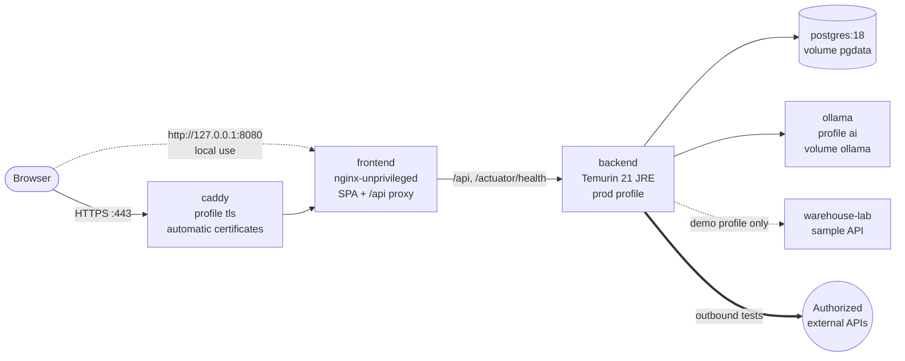

# Deployment

> Status (Phase 12): container images for the backend and frontend, a Compose stack (PostgreSQL, backend, frontend; optional Ollama, Caddy for HTTPS and a demo target), GitHub Actions for tests, images, end-to-end tests on the stack, dependency scanning and image releases. The stack was built and verified from a clean environment (PROJECT_STATUS.md, Phases 11 and 12). Provider-specific statements in §10–§11 were checked on 2026-10-23; free tiers change often, so check the provider's current terms before relying on them.

## 1. Prerequisites

| Tool | Version | Needed for |
|---|---|---|
| Docker Engine or Docker Desktop with Compose v2 | current | The stack, Testcontainers |
| JDK | 21 (LTS) | Backend development outside Docker |
| Node.js | 24 LTS | Frontend development and end-to-end tests |
| Ollama | 0.40.x | AI features (in Compose or natively) |
| Maven | not required | The project ships the Maven Wrapper |

Disk: the two application images take about 0.5 GB; building them needs roughly 2 GB of build cache (removable with `docker builder prune`). The Ollama image is about 3.4 GB compressed, and each model several GB more (§9).

## 2. The Compose stack



```bash
cp .env.example .env
# Set at least: APIFORGE_DB_PASSWORD, APIFORGE_SECRETS_KEY (openssl rand -base64 32).
# For http://localhost only: APIFORGE_COOKIE_SECURE=false.
docker compose up -d --build            # http://localhost:8080
docker compose ps                       # postgres, backend, frontend: healthy
```

| Profile | Adds | Use |
|---|---|---|
| *(none)* | `postgres`, `backend`, `frontend` | Every installation |
| `ai` | `ollama` (model volume, no published port) and a one-shot `ollama-pull` of `APIFORGE_AI_MODEL` | AI in a container (§9); set `APIFORGE_STACK_OLLAMA_URL=http://ollama:11434` (the default) |
| `tls` | `caddy` on ports 80/443 with automatic certificates for `APIFORGE_DOMAIN` | Single-server deployments (§10, option A). Also set `APIFORGE_PROXY_TRUSTED=true` |
| `demo` | `warehouse-lab`, trusted as an outbound target when `APIFORGE_DEMO_TARGET_ENABLED=true` | Local evaluation and CI end-to-end tests only — never in a deployment |

Properties of the stack:

- **Published ports**: the frontend on `127.0.0.1:8080` (`APIFORGE_HTTP_BIND`, `APIFORGE_HTTP_PORT`) and PostgreSQL on `127.0.0.1:5432` (`APIFORGE_DB_PORT`) — loopback only. The backend and Ollama are not published at all. Only the `tls` profile listens on public interfaces (80/443). On a server, the PostgreSQL mapping can be removed entirely.
- **Startup order**: `backend` starts after `postgres` is healthy (`pg_isready`), `frontend` after `backend` is ready (`/actuator/health/readiness`, which includes the database), `caddy` after `frontend`. `restart: unless-stopped` everywhere.
- **Persistent data**: named volumes `pgdata` (database), `ollama` (models), `caddy-data`/`caddy-config` (certificates). `docker compose down` keeps them; `down -v` deletes them.
- **Secrets**: only in `.env` (git-ignored) and passed as environment variables at runtime. No image contains credentials, `.env` files or keys (verified, Phase 11). For hosts that support it, use the platform's secret store instead of a `.env` file.
- **Development from source** still needs only `docker compose up -d postgres` (§7).

### 2.1 Images

| Image | Build | Runtime |
|---|---|---|
| `backend/Dockerfile` | `eclipse-temurin:21.0.12.1_1-jdk-alpine`, Maven Wrapper with a dependency cache, Spring Boot layered extraction; tests are run by CI, not in the image build | `eclipse-temurin:21.0.12.1_1-jre-alpine`, user 10001, `SPRING_PROFILES_ACTIVE=prod`, `-XX:MaxRAMPercentage=75 -XX:+ExitOnOutOfMemoryError`, health check on `/actuator/health/readiness` |
| `frontend/Dockerfile` | `node:24.22.0-alpine`, `npm ci`, `npm run build` (type check + Vite) | `nginxinc/nginx-unprivileged:1.30.6-alpine` (non-root, port 8080), health check on `/healthz` |

Base images are pinned to exact versions and updated through Dependabot pull requests (§8), which run the full CI.

### 2.2 nginx (frontend container)

- Serves the single-page app (client-side routes fall back to `index.html`, which is never cached; hashed `/assets/` are cached for a year).
- Forwards `/api/` to `APIFORGE_BACKEND_URL` (default `http://backend:8081`), so the browser talks to **one origin**: the session cookie (`SameSite=Lax`) and the CSRF cookie (`SameSite=Strict`, read by the app) stay first-party. Hosting the static files on a different site from the API is therefore not supported.
- Resolves the backend's name per request through Docker's DNS (cached 10 s), so a recreated or redeployed backend container with a new address is found without restarting nginx (a startup-time lookup caused 502s until restart; found and fixed in Phase 12).
- Waits up to `APIFORGE_PROXY_READ_TIMEOUT` (default `300s`) for a backend response. An AI call may take twice `APIFORGE_AI_REQUEST_TIMEOUT` (one retry after invalid model output), so keep this above that; otherwise the browser receives a 504 while the backend is still working (found and fixed in Phase 12).
- Forwards only `GET /actuator/health` (the aggregated status, no details) of the management endpoints; every other `/actuator` path is a 404 at nginx.
- Sets security headers: a Content-Security-Policy without inline or `eval` scripts (`script-src 'self'`; inline styles are allowed for the UI components), `X-Frame-Options: DENY`, `nosniff`, `Referrer-Policy`, `Permissions-Policy`, `Cross-Origin-Opener-Policy`; hides its version.
- **Client address**: nginx replaces `X-Forwarded-For`/`X-Forwarded-Proto` with its own view unless `APIFORGE_PROXY_TRUSTED=true`. Set it to `true` only when users can reach nginx **solely** through Caddy or a load balancer; otherwise a client could choose the address used for rate limits and the audit log (found and fixed in Phase 11). Behind Caddy without the flag, every user appears with Caddy's address and shares one rate-limit bucket.

## 3. Configuration (environment variables)

`.env.example` lists every variable with safe placeholders. The Compose stack always uses the `prod` profile.

| Variable | Default | Production | Purpose |
|---|---|---|---|
| `SPRING_PROFILES_ACTIVE` | `dev` (from source), `prod` (image) | `prod` | Profile (§4) |
| `APIFORGE_DB_URL` | `jdbc:postgresql://localhost:5432/apiforge`; Compose sets `postgres:5432` | **required** | JDBC URL. Managed databases: add `?sslmode=verify-full` (or `require`) |
| `APIFORGE_DB_NAME` / `APIFORGE_DB_PORT` | `apiforge` / `5432` | — | Compose database name and loopback port |
| `APIFORGE_DB_USER` / `APIFORGE_DB_PASSWORD` | `apiforge` / — | **required**, long random password | Credentials |
| `APIFORGE_DB_POOL_SIZE` | `10` | by database plan | Connection pool (free database tiers allow few connections) |
| `APIFORGE_SECRETS_KEY` | dev-only key (dev profile) | **required**: base64 of 32 random bytes; startup fails without it | AES-GCM key for environment secrets. **Back it up separately** (§6) |
| `APIFORGE_SECRETS_KEY_ID` | `k1` | label of the current key | Stored with each encrypted value |
| `APIFORGE_COOKIE_SECURE` | `false` (dev), `true` (prod, Compose) | `true` | `Secure` session and CSRF cookies. `false` only for `http://localhost` |
| `APIFORGE_FORWARD_HEADERS_STRATEGY` | `native` (prod) | `native` | Honour `X-Forwarded-*` from private-network proxies (client IP for rate limits and audit, HTTPS scheme) |
| `APIFORGE_PROXY_TRUSTED` | `false` | `true` behind Caddy or a load balancer only (§2.2) | Whether nginx passes on client-supplied forwarding headers |
| `APIFORGE_PROXY_READ_TIMEOUT` | `300s` | more than 2 × `APIFORGE_AI_REQUEST_TIMEOUT` (§2.2) | How long nginx waits for the backend |
| `APIFORGE_AUTH_REGISTRATION_ENABLED` | `true` | `false` on any publicly reachable instance once the needed accounts exist: with open registration, anyone can use the instance to send requests to public hosts (SECURITY.md §11.1, R1) | Self-registration |
| `APIFORGE_CORS_ALLOWED_ORIGINS` | empty | empty (same origin) | Only when an approved UI runs on another origin |
| `APIFORGE_SESSION_IDLE_TIMEOUT` / `_ABSOLUTE_TIMEOUT` | `30m` / `12h` | as required | Session lifetimes |
| `APIFORGE_SPEC_MAX_SIZE` | `5MB` | — | OpenAPI document limit |
| `APIFORGE_OUTBOUND_CONNECT_TIMEOUT` / `_TOTAL_DEADLINE` | `5s` / `30s` | — | Outbound request limits |
| `APIFORGE_OUTBOUND_ALLOW_TRUSTED_IN_PROD` | `false` | `false` | Explicit acknowledgement for trusted targets with `prod` (demo profile only) |
| `APIFORGE_AI_ENABLED` | `true` | `false` when no model server is available | AI features |
| `OLLAMA_BASE_URL` (from source) / `APIFORGE_STACK_OLLAMA_URL` (Compose) | `http://localhost:11434` / `http://ollama:11434` | private address only (§9) | Ollama endpoint; no credentials in the URL |
| `APIFORGE_AI_MODEL`, `APIFORGE_AI_REQUEST_TIMEOUT`, `APIFORGE_AI_MAX_CONCURRENT`, `APIFORGE_AI_CONTEXT_TOKENS` | `qwen2.5:7b`, `120s`, `1`, `8192` | by hardware (§9) | Model settings |
| `APIFORGE_HTTP_BIND` / `APIFORGE_HTTP_PORT` | `127.0.0.1` / `8080` | `127.0.0.1` behind Caddy; the platform's port on a PaaS | Frontend listener |
| `APIFORGE_DOMAIN` | — | the public host name (tls profile) | Certificate name for Caddy |
| `APIFORGE_DEMO_TARGET_ENABLED` | `false` | `false` | demo profile only |
| `APIFORGE_IMAGE_TAG` | `local` | release tag | Image tag used by Compose |

## 4. Profiles

| Profile | Behaviour |
|---|---|
| `dev` | Human-readable logs, the local sample API as trusted target, a public dev-only secrets key |
| `test` | Used by the backend tests; Testcontainers provides the database; a scripted fake Ollama |
| `prod` | ECS JSON logs, no trusted targets, `Secure` cookies, forwarded headers from private proxies, every required value without a default (startup fails instead of falling back) |

## 5. Health checks and management endpoints

| Endpoint | Exposure | Content |
|---|---|---|
| `/actuator/health` | public through nginx | Aggregated status and component names, never details (`show-details: never`) |
| `/actuator/health/readiness` | inside the network (container health check) | Application state and database. AI is not part of readiness: an Ollama outage never marks the app down |
| `/actuator/health/liveness` | inside the network | Application state |
| `/actuator/info` | inside the network | Build version (the UI uses `/api/v1/system/info`) |
| everything else | not exposed (`management.endpoints.web.exposure.include=health,info`) | — |

The backend port is not published, so management endpoints other than the aggregated health are reachable only from other containers. Use `/actuator/health` (via the public URL) for uptime monitoring.

## 6. Database: migrations, backup and recovery

### 6.1 Migration strategy

- **Flyway**, versioned SQL files `V<n>__<description>.sql` in `backend/src/main/resources/db/migration`, applied automatically at backend startup before the app accepts requests (readiness stays down until then). `validate-on-migrate` refuses a database whose applied history differs from the files; `clean` is disabled.
- **Forward only**: an applied migration is never edited or deleted; corrections are new migrations. There are no down-migrations — rollback means restoring a backup (§6.2) or deploying a corrective migration.
- **Compatible changes**: prefer expand → migrate data → contract across releases (add a nullable column, deploy code that writes both, backfill, later remove the old one), so a failed release can return to the previous image without schema conflicts.
- **Before every production upgrade**: take a backup (§6.2), read the new migrations in the release, then start the new image. Watch the log for `Successfully applied` / `Schema "public" is up to date`.
- **Single instance** (ADR-008): one backend runs the migration. A future multi-instance setup must start one instance first (Flyway also takes a database lock).
- **Tested**: every migration on an empty database (Testcontainers, `SchemaIntegrationTest`) and incrementally on the development database at each phase; Phase 11 applied V1–V13 to a fresh Compose database and verified a restart with no migration necessary.

### 6.2 Backup and recovery

| What | How | Note |
|---|---|---|
| PostgreSQL | `docker compose exec -T postgres pg_dump -U apiforge -Fc apiforge > apiforge-$(date +%F).dump` daily; keep several generations (e.g. 7 daily, 4 weekly) **off the server**, encrypted | Logical backups are consistent and portable across PostgreSQL versions. Managed databases: use the provider's automated backups / point-in-time recovery and still export periodically |
| Secrets key | Store `APIFORGE_SECRETS_KEY` (and its id) in a password manager or secret store, **separately** from database backups | Without it, encrypted environment secrets in a restored database cannot be decrypted (users re-enter them). Never store it next to the dump |
| Ollama models | none | Re-downloadable (`ollama pull`) |
| Caddy data | optional | Certificates are re-issued automatically (watch Let's Encrypt rate limits when recreating often) |

Restore into an empty database:

```bash
docker compose stop backend
docker compose exec -T postgres dropdb -U apiforge apiforge
docker compose exec -T postgres createdb -U apiforge apiforge
docker compose exec -T postgres pg_restore -U apiforge -d apiforge --no-owner < apiforge-YYYY-MM-DD.dump
docker compose start backend      # Flyway applies newer migrations, if any
```

Test a restore regularly (into a scratch Compose project: `docker compose -p apiforge-restore-test …`). PostgreSQL major upgrades: dump with the old version, restore into the new one. Run history grows with use; delete old projects or runs rather than relying on unbounded storage on free database tiers.

## 7. Development from source

```bash
docker compose up -d postgres            # database only, on 127.0.0.1:5432
cd backend && ./mvnw spring-boot:run     # :8081, profile dev
cd frontend && npm run dev               # :5173, Vite proxies /api → :8081
node samples/warehouse-lab-server.mjs    # :8090, trusted target in the dev profile
ollama serve && ollama pull qwen2.5:7b   # optional (docs/AI.md)
```

## 8. CI/CD (GitHub Actions)

| Workflow | Trigger | Jobs |
|---|---|---|
| `ci.yml` | push to `main`, pull requests | **backend**: `./mvnw -B verify` (Testcontainers, JaCoCo gates, reports uploaded). **frontend**: lint, type check, tests with coverage, build, `npm audit --omit=dev --audit-level=high`. **compose**: the database service as used for development. **stack** (after backend and frontend): builds both images (BuildKit cache), starts the complete stack from a clean environment with secrets generated for the run (demo profile, AI disabled), checks health, closed management endpoints and migrations, runs the Playwright end-to-end suite against it, uploads the report and container logs on failure, removes everything |
| `dependencies.yml` | pull requests, `main`, weekly, manual | OSV-Scanner (checksum-verified) over the backend's runtime SBOM (CycloneDX) and the frontend and e2e lockfiles; fails on known vulnerabilities |
| `release.yml` | tags `v*.*.*` | Builds and pushes `ghcr.io/<owner>/apiforge-backend` and `apiforge-frontend` (version, minor and commit tags, provenance and SBOM attestations) with `GITHUB_TOKEN` only |
| `dependabot.yml` | weekly | Update pull requests for Maven, npm (frontend, e2e), Dockerfiles, Compose images and the actions |

Actions are pinned to commit SHAs. Ollama is not run in CI (no GPU, 3.4 GB image); AI behaviour is covered by the backend's scripted fake and by local end-to-end runs with a real model. The workflows were validated with `actionlint`; they run on GitHub, not in this environment, so their first run on GitHub is the remaining verification (PROJECT_STATUS.md).

Deployment from a release: on the server, set `APIFORGE_IMAGE_TAG`, replace `build:` by the GHCR image names (or `docker pull` and retag), then `docker compose pull && docker compose up -d`. Take a database backup first (§6.1).

## 9. Ollama: local versus remote

| Model | Download | Memory to run | CPU only | With a GPU |
|---|---|---|---|---|
| `llama3.2:3b` | ≈ 2 GB | ≈ 4 GB RAM, or ≥ 4 GB VRAM | 167–209 s per test-suggestion request (measured in the `ai` profile, Docker VM with 16 vCPU and 8 GB) | a few seconds |
| `qwen2.5:7b` (default) | ≈ 4.7 GB | ≈ 8 GB RAM, or ≥ 6 GB VRAM | slower than `llama3.2:3b` (not measured) | 5–35 s (measured, docs/AI_EVALUATION.md) |

- **Local** (Ollama on the same machine, natively or in the `ai` profile): simplest and private. The machine needs the model's memory **in addition to** the stack (backend ≈ 0.5–1 GB, PostgreSQL ≈ 0.2 GB, nginx negligible). Docker Desktop's VM memory limit applies to the `ai` profile; GPU use in a container needs the NVIDIA Container Toolkit and a `gpus: all` override. On Windows and macOS a native Ollama with `APIFORGE_STACK_OLLAMA_URL=http://host.docker.internal:11434` often uses the GPU more easily.
- **CPU-only timeouts**: the defaults (`APIFORGE_AI_REQUEST_TIMEOUT=120s`, `APIFORGE_PROXY_READ_TIMEOUT=300s`) suit a GPU. On CPU only, set for example `APIFORGE_AI_REQUEST_TIMEOUT=600s` and `APIFORGE_PROXY_READ_TIMEOUT=1300s`; with the defaults, CPU-only suggestions end in a clean "did not answer within the request timeout" error (verified in Phase 12). With those settings the `ai` profile (model pulled into the `ollama` volume, port not published) passed the AI end-to-end journey.
- **Remote** (a GPU server elsewhere): needed when the application host is small. Free and entry-level cloud instances do not have the memory for a 3–7 B model at useful speed, and GPU instances are billed by the hour; budget accordingly or disable AI (`APIFORGE_AI_ENABLED=false` — everything else keeps working).
- **Keep the model endpoint private**: Ollama has no authentication. Never publish port 11434 (the Compose stack does not). For a remote model server, connect the two hosts over a private network or VPN (cloud VPC, WireGuard, Tailscale) and point `OLLAMA_BASE_URL` at the private address; restrict the model host's firewall to the backend's address. `OLLAMA_BASE_URL` must not carry credentials (rejected at startup), so protection is at the network level. Prompts contain redacted test data only (docs/AI.md), but the endpoint would still let anyone use the GPU.

## 10. Hosting options

Requirements: the backend needs ≥ 1 GB RAM (JVM, `MaxRAMPercentage=75`), the stack without AI fits in 2 GB, one backend instance (in-memory sessions and rate limits), outbound internet access to the APIs being tested, and frontend and API on one origin (§2.2).

**Option A — one small virtual server with the Compose stack (recommended, low cost).** A VPS or cloud VM with 2 vCPU and 2–4 GB RAM runs the whole stack: `docker compose --profile tls up -d` with `APIFORGE_DOMAIN`, `APIFORGE_PROXY_TRUSTED=true`, a strong `.env`, a firewall that allows only 22 (restricted), 80 and 443, the PostgreSQL port mapping removed, and daily off-site backups (§6.2). Cost: the price of one small instance per month (commonly a few US dollars or euros). Oracle Cloud's Always Free Ampere A1 shapes can run it at no cost, but Oracle documents that idle Always Free instances can be reclaimed, capacity is often unavailable in popular regions, and the allowance has changed before; it is not a dependable production home. AI on the same server needs §9's memory on top.

**Option B — container platform plus managed PostgreSQL.** Run the frontend image as the only public service and the backend image as a private service on the platform's internal network (`APIFORGE_BACKEND_URL` pointing at it), with a managed PostgreSQL reached over private networking. If the provider only offers a public database endpoint, require TLS (`sslmode=verify-full`), a long random password and an IP allow-list for the backend's egress address; the database must not be open to the whole internet. Constraints: the backend must stay at exactly one instance and should not scale to zero (sign-ins are lost on every restart, and a cold JVM start takes tens of seconds); the platform must allow outbound connections to arbitrary hosts.

**Static hosting of the frontend alone** (CDN-only hosts) is not supported: the API would be on another site, and the session and CSRF cookies are first-party by design.

## 11. Free-tier limitations (checked 2026-10-23)

A fully free, dependable deployment is not available from the options reviewed:

- **Databases**: Render's free PostgreSQL expires 30 days after creation (then 14 days' grace before deletion) and has 1 GB; Neon's free plan has 0.5 GB per project, 100 compute-hours per month, and suspends after 5 minutes idle (the first request then waits for a cold start). Fine for a trial, not for keeping test history.
- **Compute**: free web services commonly spin down when idle (Render: a request then waits up to about a minute) and have ephemeral filesystems; with in-memory sessions, every spin-down signs everyone out. Oracle's Always Free VMs can be reclaimed when idle and are capacity-limited.
- **AI**: no free tier offers the memory or GPU for a 3–7 B model at usable speed (§9). Deploy with AI disabled, or run Ollama on your own hardware reachable over a VPN.
- **Persistent volumes**: free container tiers usually have none, so PostgreSQL cannot run next to the app there; a managed database (with the limits above) is needed.

Lowest-cost dependable setup: Option A on a small paid VM, AI disabled or on a separate machine you own.

## 12. Secure networking for outbound API execution

The backend sends test requests to user-configured URLs. The application blocks private, loopback, link-local, metadata and other special ranges, validates DNS answers before connecting and re-checks redirects (SECURITY.md §6). At the network level, additionally:

- **Block cloud metadata endpoints** for the backend (169.254.169.254, fd00:ec2::254 and provider equivalents) with host firewall rules or provider settings (e.g. require IMDSv2 with a hop limit of 1 on AWS), as defence in depth.
- **Isolate the backend's network**: do not place it in a subnet or Docker network that can reach internal admin services, databases other than its own, or other tenants. The Compose network contains only this stack.
- **Egress**: allow outbound HTTP(S) to the internet (the APIs being tested); deny everything else that is not needed. Where policy requires an allow-list, list the authorized test APIs. The outbound client ignores system proxy settings by design (every connection is checked by the guard); an egress proxy must be transparent (firewall/NAT level).
- **No trusted targets in production**: the `demo` profile's trusted sample API is for local evaluation only; `prod` refuses trusted targets unless explicitly acknowledged.
- **Authorization**: only test APIs you own or are authorized to test (shown in the UI when creating the first environment).

## 13. Logging and error monitoring

- **Logs**: the `prod` profile writes ECS JSON to stdout, one event per line, with the request id (also returned to clients as `X-Request-Id` and in every error response). Bodies, header values, secrets, passwords and e-mail addresses are never logged (tested, QA_REPORT.md). Collect stdout with the platform's log service or the Docker logging driver (`docker compose logs`, journald, Loki/Grafana, a cloud logging service); set retention to your audit needs and configure log rotation on servers (`json-file` with `max-size`/`max-file`).
- **What to alert on**: health not `UP` (uptime check on `https://<domain>/actuator/health`), `log.level` `ERROR` events, rising 5xx responses in the access log (`com.apiforge.access`), container restarts, disk usage of the database volume, failed backups.
- **Error monitoring**: no third-party error service is integrated or required. If you add one (e.g. an OpenTelemetry collector, Sentry or GlitchTip via a Java agent in `JAVA_TOOL_OPTIONS`), configure it not to capture request bodies, headers or local variables, so redacted data stays redacted; correlate events with the request id.
- **Audit trail**: security events are stored in the `audit_events` table (sign-ins, lockouts, account and project changes, secret changes, AI use) and are part of the database backup.
