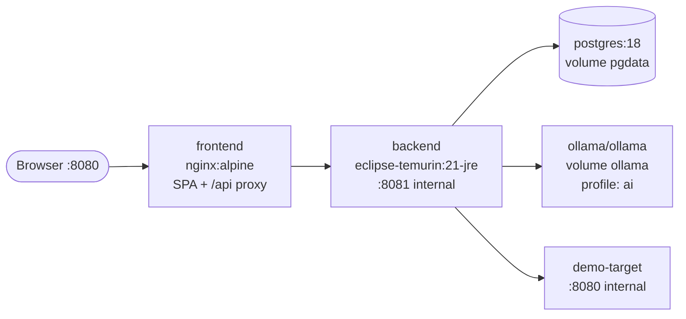

# Deployment

> Status: **Phase 1**. `docker-compose.yml` provides PostgreSQL (implemented and verified). The backend and frontend run from source (README quick start). Their Dockerfiles, nginx and the full-stack Compose topology below arrive in Phase 8.

## 1. Prerequisites

| Tool | Version | Needed for |
|---|---|---|
| Docker Desktop / Docker Engine + Compose v2 | current | Full stack, Testcontainers |
| JDK | 21 (LTS) | Backend development outside Docker |
| Node.js | 24 LTS recommended; minimum 22.22 (React Router 8 requires ≥ 22.22, Vite 8 ≥ 22.12) | Frontend development outside Docker |
| Ollama | current | AI features (in Compose or natively) |
| Maven | not required | The project ships the Maven Wrapper (`mvnw`) |

## 2. Docker Compose topology



- Only the frontend port is published by default (`8080:80`). Backend, Postgres, Ollama and demo-target are on an internal network. Optional `ports:` for local debugging are in `docker-compose.override.yml.example`.
- Ollama runs under the Compose profile `ai` (`docker compose --profile ai up`). Without it, the app runs with AI shown as unavailable and deterministic features fully working. Users who already run Ollama natively can set `OLLAMA_BASE_URL=http://host.docker.internal:11434`.
- A one-shot `ollama-pull` service (profile `ai`) pulls `${APIFORGE_AI_MODEL}` once. The app itself never pulls models at startup (`spring.ai.ollama.init.pull-model-strategy=never`).

## 3. Configuration (environment variables)

| Variable | Default (dev) | Prod requirement | Purpose |
|---|---|---|---|
| `SPRING_PROFILES_ACTIVE` | `dev` | `prod` | Profile |
| `APIFORGE_DB_URL` | `jdbc:postgresql://localhost:${APIFORGE_DB_PORT}/${APIFORGE_DB_NAME}` | required | JDBC URL |
| `APIFORGE_DB_NAME` / `APIFORGE_DB_PORT` | `apiforge` / `5432` | — | Database name and host port (Compose publishes on 127.0.0.1 only) |
| `APIFORGE_DB_USER` / `APIFORGE_DB_PASSWORD` | `apiforge` / *(from .env, required)* | required, strong | DB credentials |
| `APIFORGE_DB_POOL_SIZE` | `10` | — | Hikari pool size |
| `APIFORGE_SERVER_PORT` | `8081` | — | Backend HTTP port |
| `APIFORGE_CORS_ALLOWED_ORIGINS` | `http://localhost:5173` (dev only) | only if the UI is on another origin | Explicit CORS origins for `/api/**` |
| `APIFORGE_SECRETS_KEY` | dev-only key in `application-dev.yml` | **required** (32 bytes base64); startup fails if missing | AES-GCM key for environment secrets |
| `APIFORGE_AUTH_REGISTRATION_ENABLED` | `true` | as needed | Open self-registration (`false` → 403 `REGISTRATION_DISABLED`) |
| `APIFORGE_SPEC_MAX_SIZE` | `5MB` | — | Maximum OpenAPI document size (also update `spring.servlet.multipart.*` if raised) |
| `APIFORGE_SESSION_IDLE_TIMEOUT` | `30m` | — | Session idle timeout |
| `APIFORGE_SESSION_ABSOLUTE_TIMEOUT` | `12h` | — | Maximum session lifetime after sign-in |
| `APIFORGE_OUTBOUND_TRUSTED_TARGETS_ENABLED` | `true` | `false` | Allow configured private targets |
| `APIFORGE_OUTBOUND_TRUSTED_TARGETS` | `demo-target:8080,localhost:8090` | empty | Trusted host:port list |
| `APIFORGE_OUTBOUND_ALLOW_TRUSTED_IN_PROD` | — | only for self-hosted single-user | Explicit acknowledgement |
| `APIFORGE_AI_ENABLED` | `true` | as needed | Turn AI off completely |
| `OLLAMA_BASE_URL` | `http://ollama:11434` | — | Ollama endpoint (server config only) |
| `APIFORGE_AI_MODEL` | `llama3.2:3b` | — | Model name (see ADR-019) |
| `APIFORGE_AI_TIMEOUT` | `120s` | — | Per-call timeout |
| `APIFORGE_COOKIE_SECURE` | `false` (`true` in the `prod` profile) | `true` (served over HTTPS) | `Secure` flag on the session and CSRF cookies |

Variables for later phases (secrets key, outbound, AI) are not read yet. `.env.example` documents every variable in use, with safe placeholders. `.env` is git-ignored. No secret is committed. The dev secrets key is labelled as dev-only and rejected by the `prod` profile.

## 4. Profiles

| Profile | Behaviour |
|---|---|
| `dev` | Human-readable logs, trusted targets enabled, dev secrets key allowed, health details shown to authenticated users |
| `test` | Used by tests; Testcontainers provides the DB; stub AI model |
| `prod` | ECS JSON logs, strict outbound policy, `Secure` cookies, HSTS, startup validation of required secrets |

## 5. Health checks

- Backend container `HEALTHCHECK` uses `/actuator/health/readiness` (DB included, Ollama excluded).
- Compose `depends_on: condition: service_healthy` for backend → postgres and frontend → backend.

## 6. Local development without Docker for the apps

```bash
docker compose up -d postgres            # DB only
cd backend && ./mvnw spring-boot:run     # :8081, profile dev
cd frontend && npm run dev               # :5173, Vite proxies /api → :8081
cd demo-target && ./mvnw spring-boot:run # :8090, trusted target in dev profile
ollama serve && ollama pull llama3.2:3b  # optional
```

## 7. CI/CD (GitHub Actions)

`ci.yml` on push and pull requests:

1. **backend**: Temurin 21, Maven cache, `./mvnw -B verify` (Testcontainers uses the runner's Docker), upload JaCoCo report.
2. **frontend**: Node 24, `npm ci`, lint, typecheck, test with coverage, build.
3. **e2e** (needs 1 and 2): `docker compose up -d --build --wait`, Playwright smoke tests, upload traces on failure.
4. **docker**: build images and, on tags only, push to GHCR with the commit SHA and version tags.

Ollama is not run in CI. AI behaviour is covered by stub-model tests.

## 8. Production notes

- Terminate TLS in front of the frontend (reverse proxy or platform load balancer). The `prod` profile marks cookies `Secure` by default. Enable `server.forward-headers-strategy=native` (or `framework`) behind the proxy so client IPs used for rate limiting and auditing are correct.
- Run a single backend instance (in-memory sessions and rate limits; ADR-008, ADR-014). Horizontal scaling would require Spring Session JDBC and a shared rate-limit store. This is documented as a known limitation, not implemented.
- Back up the Postgres volume. The secrets key must be backed up separately: losing it makes stored secrets unrecoverable.
- If the backend runs in a cloud VM, the outbound blocklist covers metadata endpoints. Platform-level egress controls (security groups, network policies) are still recommended as defence in depth.
