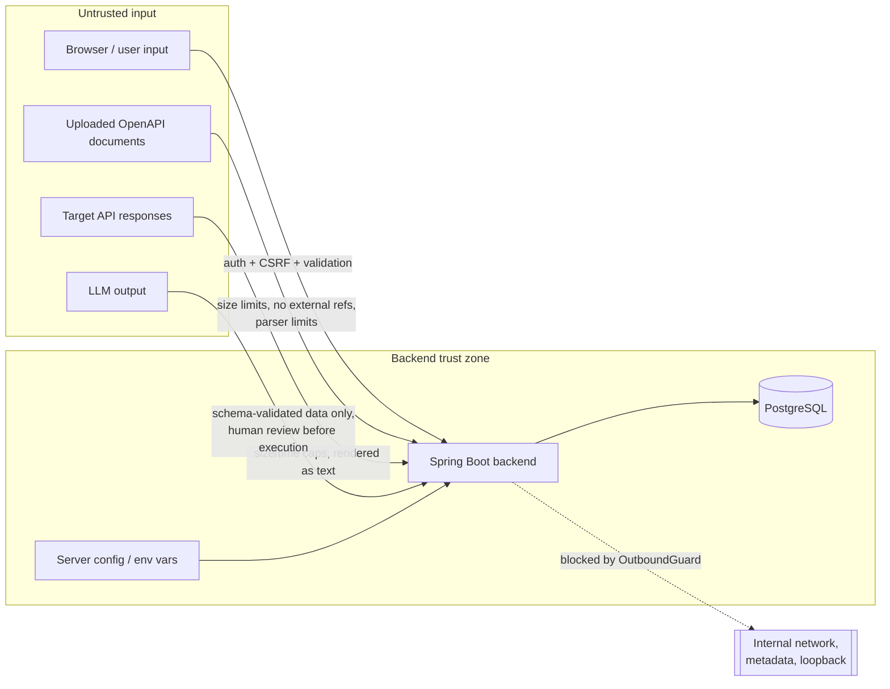
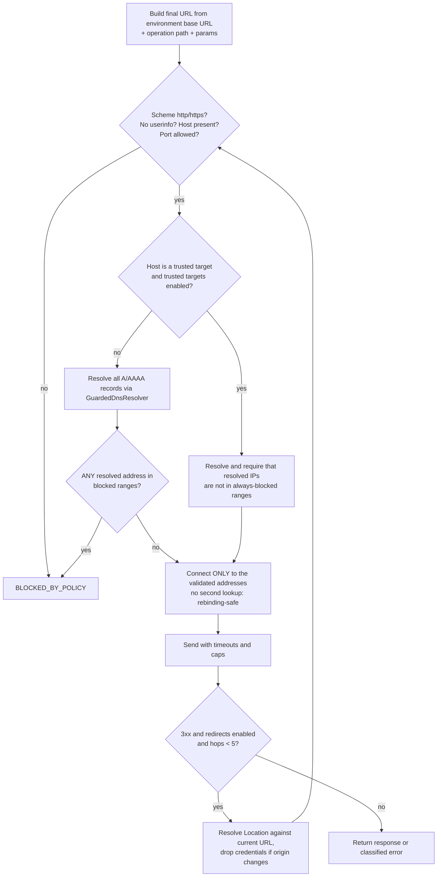

# Security

> Status: §3 (authentication and sessions), §4 (authorization) and the secrets-at-rest database constraint (Phase 2), and §5 (untrusted OpenAPI documents, Phase 3) are **implemented and tested**. All other sections remain requirements for later phases; each control is marked when its phase delivers it.

APIForge AI makes HTTP requests to user-supplied URLs, stores credentials for those APIs, parses untrusted documents, and sends data to an LLM. Each of these is a significant attack surface. This document is the threat model and the list of required controls.

## 1. Assets

| Asset | Why it matters |
|---|---|
| User credentials and sessions | Account takeover exposes every project and stored secret |
| Environment secrets (tokens, API keys, passwords for target APIs) | Credentials to *other* systems |
| Project data (specs, tests, history) | Confidential API designs and response data |
| The backend's network position | Can reach Postgres, Ollama, cloud metadata and internal services the user cannot |
| Host resources (CPU, memory, connections) | Denial of service through large specs or responses, slow targets, or the LLM |
| Integrity of verdicts | A false "passed" is a product-level security and quality failure |

## 2. Trust boundaries



Everything in the *Untrusted input* box is treated as data. Even response bodies from a "trusted" demo target are rendered as text and limited in size.

## 3. Authentication and sessions ✅ Phase 2

| Control | Implementation | Verified by |
|---|---|---|
| Password storage | `DelegatingPasswordEncoder` with bcrypt, cost 12 (configurable 4–16; tests use 4). Hashes carry an algorithm prefix (`{bcrypt}…`) so the algorithm can change later. A database check constraint rejects anything that is not encoder output | `AuthIntegrationTest.registrationCreatesAccountStoresOnlyBcryptHashAndSignsIn`, `SchemaIntegrationTest.plaintextPasswordCannotBeStored` |
| Password policy | 12–64 characters, ≤ 72 bytes UTF-8 (bcrypt's limit; rejected rather than truncated), not whitespace-only, not in a bundled list of common long passwords, not containing the e-mail address (or its local part, if ≥ 4 characters). No composition rules (NIST SP 800-63B) | `PasswordPolicyTest`, `AuthIntegrationTest.weakPasswordsAreRejectedByPolicy` |
| Passwords never echoed or logged | Responses contain no password field; request DTOs override `toString()` to redact it; audit log lines contain user ids only | `AuthDtosTest`, registration IT body check |
| Session | Server-side `HttpSession`, cookie `APIFORGE_SESSION`: `HttpOnly`, `SameSite=Lax`, `Secure` when `APIFORGE_COOKIE_SECURE=true` (default in `prod`), cookie-only tracking (no `;jsessionid` URLs). Idle timeout 30 min (`APIFORGE_SESSION_IDLE_TIMEOUT`), absolute timeout 12 h after sign-in (`AbsoluteSessionTimeoutFilter`) | Cookie-attribute assertions in `AuthIntegrationTest`, `AbsoluteSessionTimeoutFilterTest` |
| Session fixation | The JSON login applies `ChangeSessionIdAuthenticationStrategy` explicitly; the previous session id stops working | `AuthIntegrationTest.loginRotatesSessionIdSoAPreviousSessionCannotBeReused` |
| Logout | `POST /api/v1/auth/logout` (CSRF-protected): invalidates the server session, deletes the cookie, rotates the CSRF token; a replayed old cookie is rejected | `AuthIntegrationTest.logoutInvalidatesTheSessionServerSide` |
| CSRF | Spring Security SPA mode: `XSRF-TOKEN` cookie (readable by the SPA, `SameSite=Strict`) echoed in `X-XSRF-TOKEN`; required on every state-changing request including login, register and logout; token rotated on sign-in (`CsrfAuthenticationStrategy`) with the new cookie sent in the same response | `AuthIntegrationTest.stateChangingRequestsWithoutCsrfTokenAreRejected`, `csrfTokenIsRotatedOnLogin`, `ApiExceptionHandlerTest.postWithoutCsrfTokenIsRejected` |
| Account enumeration | Every sign-in failure (unknown e-mail, wrong password, locked or disabled account) returns the same 401 `BAD_CREDENTIALS` and message. Unknown e-mails still cost a bcrypt computation (Spring's dummy-hash check). The lock is enforced **after** password verification, so a locked account answers at the same speed. Registration necessarily reveals an existing address (409 `EMAIL_TAKEN`); it is rate-limited | `AuthIntegrationTest.invalidCredentialsGiveIdenticalResponsesForUnknownEmailAndWrongPassword` |
| Brute force: per account | 5 consecutive failures lock sign-in for 15 minutes, even with the correct password; the counter restarts after a lock and resets on success. Failure counting takes a row lock, so concurrent attempts cannot under-count | `UserLockoutTest`, `AuthIntegrationTest.accountLocksAfterRepeatedFailuresEvenForTheCorrectPasswordUntilLockExpires` |
| Brute force: per client | In-memory fixed-window limits per client IP: 10 sign-ins and 5 registrations per minute, applied before any hashing; 429 `RATE_LIMITED` with `Retry-After`. Behind a reverse proxy, enable `server.forward-headers-strategy` so the client IP is correct; `X-Forwarded-For` is never trusted directly | `FixedWindowRateLimiterTest`, `RestrictedAuthConfigurationIntegrationTest` |
| Registration switch | `APIFORGE_AUTH_REGISTRATION_ENABLED=false` → 403 `REGISTRATION_DISABLED` | `RestrictedAuthConfigurationIntegrationTest.registrationCanBeDisabled` |
| Audit trail | `audit_events` records registration, sign-in success and failure (with the attempted e-mail), lockouts, sign-out, project creation and deletion, and cross-user access attempts, with client IP and request id. Append-only (database trigger) | Assertions in the auth and cross-user ITs, `SchemaIntegrationTest.historyAndSpecificationsAreImmutable` |

Known limitations: sessions and rate-limit counters are in memory (single backend instance; a restart signs everyone out). A disabled account is rejected before password verification, which is measurably faster; there is no account-disabling feature yet. Password change (which will also end other sessions) arrives with the account settings page.

ADR-008 records why session + CSRF was chosen over JWT in `localStorage`.

## 4. Authorization ✅ Phase 2

- **API level**: every endpoint requires an authenticated session except an explicit allow-list (`/actuator/health/**`, `/actuator/info`, `/api/v1/system/info`, `/api/v1/auth/csrf`, `POST /api/v1/auth/login`, `POST /api/v1/auth/register`, `/error`). Anything not listed, including unknown paths, answers 401 to anonymous callers.
- **Service level**: single role (`USER`) with **ownership-based** access. Every project-scoped service method obtains the project through `ProjectAccessService.requireOwned(projectId, userId)`, which queries by id **and** owner. Child resources are loaded through their parent (`findByIdAndProjectId`, run → results), never by bare id.
- A project that exists but belongs to someone else returns the **same 404** as a missing one (same code and message). Such attempts are recorded as `CROSS_USER_ACCESS_DENIED` audit events.
- **Database level**: composite foreign keys keep child rows (suites, test cases, runs, the active spec version) inside one project, so a bug elsewhere cannot link one user's data into another's project.
- **Architecture level**: ArchUnit rules forbid controllers and the web layer from touching repositories or entities, so authorization cannot be bypassed by a controller querying the database directly (`ArchitectureTest`).
- Verified by `CrossUserAccessIntegrationTest`: a second user receives 404 on every project-scoped read endpoint (project, runs, run, results, result), cannot update or delete, sees only their own projects in listings, cannot reach another project's run through their own project id, and the owner's data is unchanged afterwards.

## 5. Untrusted OpenAPI documents ✅ Phase 3

| Threat | Control | Verified by |
|---|---|---|
| SSRF or local file read through external `$ref` (`http(s)://…`, `file:`, relative and protocol-relative paths) | `ReferenceGuard` checks every `$ref` **before** the OpenAPI parser runs: only local JSON pointers (`#/…`) that resolve inside the document are accepted; anything else rejects the import (`EXTERNAL_REFERENCE`, `UNRESOLVED_REFERENCE`, `INVALID_REFERENCE`). The parser then receives the document as a JSON string (`readContents`, no location), so there is nothing it could fetch | `SpecificationAnalyzerTest.externalReferencesAreRejectedBeforeParsing` (7 forms incl. the cloud-metadata IP), `SpecificationImportIntegrationTest.externalReferenceIsRejectedWithoutAnyOutboundRequest` (a live local server receives **0** requests) |
| `servers[].url` used as a request target | Servers are informational only; requests use an environment's base URL, which passes the outbound policy | (Phase 4) |
| YAML "billion laughs", recursive anchors, deep nesting, huge documents | 5 MB limit (multipart limits, a request-size filter for every body including chunked ones, and a service check); YAML loaded with SnakeYAML under explicit limits: ≤ 50 aliases to collections, nesting depth ≤ 100, code-point limit, no duplicate or recursive keys, recursive structures rejected; JSON parsed with Jackson stream constraints (depth, string and document length) | `SpecificationAnalyzerTest` (alias bomb, recursive anchor, nesting), `RequestSizeLimitFilterTest`, `oversizedUploadIsRejectedWith413`, `oversizedPastedTextIsRejectedWith413` |
| Duplicate keys hiding paths or operations | Rejected for YAML and JSON (`DUPLICATE_KEY`, with line and column) | `duplicateYamlKeysAreRejected`, `duplicateJsonKeysAreRejected` |
| Binary or mis-encoded input | Strict UTF-8 decoding (BOM accepted), NUL bytes rejected | `emptyBinaryAndNonObjectDocumentsAreRejected` |
| Excessive operation count | ≤ 2,000 operations (configurable) | `operationCountLimitIsEnforced` |
| ReDoS through schema `pattern` applied to response strings | Not reachable yet (no validation runs). Phase 4: response body cap and a validation deadline or linear-time regex | (Phase 4 spike) |
| XSS through descriptions, summaries, examples | The explorer renders every spec-supplied string as text (no HTML, Markdown shown verbatim); covered by oxlint `react/no-danger` and a component test that injects markup | `SchemaView.test.tsx` ("treats description text as text, not markup") |
| Downloaded original rendered by the browser | Served as `text/plain` with `Content-Disposition: attachment` and `X-Content-Type-Options: nosniff` | `originalDocumentIsStoredByteForByte` |

## 6. Outbound request safety (SSRF) — the `outbound` module

All user-influenced outbound HTTP (test execution, ad hoc requests, connectivity checks) goes through one client, `OutboundHttpClient`. It is built on Apache HttpClient 5 with a **guarded DNS resolver**. No other code may make outbound requests to user-supplied destinations (enforced by ArchUnit).

### 6.1 Request pipeline



### 6.2 Blocked destinations (default, all profiles)

Addresses are normalized first: IPv4-mapped and IPv4-compatible IPv6 addresses are unwrapped, and NAT64 (`64:ff9b::/96`) and 6to4 (`2002::/16`) embedded IPv4 addresses are extracted and checked. Hosts are parsed by `java.net.URI` plus an explicit rejection of non-canonical numeric forms (`0x7f.1`, `017700000001`, `2130706433`, and so on).

| Range | Reason |
|---|---|
| `0.0.0.0/8`, `::/128` | "this host" |
| `127.0.0.0/8`, `::1/128` | loopback |
| `10.0.0.0/8`, `172.16.0.0/12`, `192.168.0.0/16` | RFC 1918 private |
| `100.64.0.0/10` | CGNAT (includes Alibaba metadata `100.100.100.200`) |
| `169.254.0.0/16`, `fe80::/10` | link-local (includes AWS/GCP/Azure metadata `169.254.169.254`) |
| `fc00::/7` | IPv6 unique-local (includes AWS IPv6 metadata `fd00:ec2::254`) |
| `192.0.0.0/24`, `192.0.2.0/24`, `198.18.0.0/15`, `198.51.100.0/24`, `203.0.113.0/24`, `2001:db8::/32` | IETF special-purpose and documentation |
| `224.0.0.0/4`, `ff00::/8`, `240.0.0.0/4`, `255.255.255.255/32` | multicast, reserved, broadcast |
| Hostnames `localhost`, `*.localhost`, `metadata.google.internal`, `metadata`, `*.internal` | Name-based block, checked before DNS |

If any one resolved address is blocked, the whole request is blocked. This prevents "one public A record, one private A record" tricks.

### 6.3 Trusted local targets (development only)

```yaml
apiforge:
  outbound:
    trusted-targets-enabled: true          # false in prod profile
    trusted-targets:
      - host: localhost        # demo-target run locally outside Docker
        port: 8090
      - host: demo-target
        port: 8080
```

- A trusted target matches on **exact host and port**. It bypasses only the private, loopback and CGNAT checks.
- Link-local and metadata ranges are **never** bypassable. Startup fails if a trusted target is a literal in those ranges.
- In the `prod` profile, startup fails if `trusted-targets-enabled=true` unless `APIFORGE_OUTBOUND_ALLOW_TRUSTED_IN_PROD=true` is also set, an explicit acknowledgement for self-hosted single-user installs.
- The backend's own ports, Postgres and Ollama are never on the trusted list by default.

### 6.4 Limits

| Limit | Default | Configurable |
|---|---|---|
| Connect timeout | 5 s | yes |
| Response timeout (socket) | per environment, default 15 s, max 60 s | yes |
| Total deadline per request (including redirects) | 30 s, max 90 s | yes |
| Max response body read (after decompression) | 2 MB, then abort and mark `RESPONSE_TOO_LARGE` or truncated | yes |
| Stored response body | 256 KB | yes |
| Max request body | 1 MB | yes |
| Max redirects | 5 (off by default per environment) | yes |
| Max headers in response | 100, 16 KB total | yes |
| Concurrent executions | per user 4, global 32 | yes |
| Run size | 500 tests per run | yes |
| Execution rate | 300 requests/min per user | yes |

Other client settings:

- **Proxies are ignored**: the client is built without `useSystemProperties()`, so `HTTP_PROXY` cannot redirect traffic.
- Automatic redirect handling and automatic decompression are disabled. Redirects are followed manually and revalidated; decompression is done by our capped stream wrapper.
- Header names and values are validated: CRLF is rejected; `Host`, `Content-Length`, `Transfer-Encoding`, `Connection` and other hop-by-hop headers cannot be set by tests.
- On a cross-origin redirect, `Authorization`, `Cookie` and auth query parameters are removed.
- TLS: default JVM trust store and hostname verification. No "trust all" option.

### 6.5 Execution policy (safe negative testing)

- Each test has a `risk_level` derived from its method: `READ_ONLY` (GET/HEAD/OPTIONS), `MUTATING` (POST/PUT/PATCH) or `DESTRUCTIVE` (DELETE).
- Each environment has an `execution_policy`, defaulting to `READ_ONLY`. Raising it requires a confirmation dialog stating that the target must be a non-production system the user is authorized to test.
- Generators never produce load, fuzzing or injection payloads, or oversized bodies. Boundary values are bounded: strings at most `maxLength + 1`, capped at 10,000 characters; arrays at most `maxItems + 1`, capped at 100 items; at most 100 tests per operation. ✅ Phase 4
- Schema `pattern`s come from untrusted documents. Matching runs on a character sequence with a 200,000-read budget, so a catastrophically backtracking expression is abandoned instead of blocking a request thread (ADR-025). ✅ Phase 4
- Tests are declarative data. An edited test cannot set `Host`, `Content-Length`, `Transfer-Encoding`, `Connection`, `Content-Type` (it comes from the body), `Authorization`, `Cookie` or any `Proxy-*` header. Header values cannot contain CR/LF, bodies are limited to 256 KB, and unknown JSON members (such as a `script` field) are rejected. ✅ Phase 4
- An authorization notice is shown on first environment creation. The app does not offer scanning features.

## 7. Secrets and data minimization

| Control | Detail |
|---|---|
| Encryption at rest | ✅ Phase 2 (schema): the database refuses to store a secret variable in plaintext (`ck_environment_variables_storage`). Phase 3 (cipher): secret variables are encrypted with AES-256-GCM. Key from `APIFORGE_SECRETS_KEY` (base64, 32 bytes). Startup fails in prod if missing; the dev profile uses a documented dev-only key. A `key_id` column allows rotation |
| Write-only | The API never returns secret values, only `hasValue: true` |
| Redaction | `Redactor` replaces known secret values (exact match, plus URL-encoded and Base64 forms for Basic auth) and sensitive headers (`Authorization`, `Proxy-Authorization`, `Cookie`, `Set-Cookie`, `X-API-Key`, and any header configured as an API key header) with `«redacted»`. It runs **before** persisting request and response snapshots, before logging, and before building AI prompts |
| Logging | No bodies, header values or variable values at INFO and above. Request logging includes method, host, path template, status, duration and request id. A log-capture test asserts that a planted secret never appears in logs |
| AI context | Built only from redacted snapshots. Bodies truncated to 8 KB. Never includes environment variables or auth config |

## 8. AI-specific threats

| Threat | Control |
|---|---|
| Prompt injection via response bodies or spec descriptions | Untrusted text is placed in clearly delimited data sections. The system prompt states it is data. More importantly, **output is never trusted**: it is schema-validated data with no tool calling and no execution path |
| AI output executes code or reaches arbitrary hosts | Tests are declarative (no scripts). AI suggestions may set only path params, query, headers (allowlisted, no hop-by-hop/`Host`) and body for an **existing** operation key. The base URL always comes from the environment. Every suggestion is `PENDING_REVIEW` and must be approved before it can run, and it then passes the same outbound guard |
| Hallucinated citations | Context items are given ids (`A1`, `R3`, `S2`). Output citations must reference supplied ids; unknown ids are dropped and the result is flagged |
| Oversized or malformed output | JSON schema output via Ollama `format`, then Jackson parsing with strict DTOs, Bean Validation (sizes, enums), and a max response length. Any failure leads to a deterministic fallback |
| Resource exhaustion | AI calls use a semaphore (default 2 concurrent), timeout (default 120 s), and per-user rate limit. AI failures never affect readiness or deterministic testing |
| Data leakage to a third party | Ollama URL is server config only. No paid or remote AI API is used. Docs warn that pointing `OLLAMA_BASE_URL` at a remote host sends redacted test data there |

## 9. Web application hardening

- ✅ API responses (Phase 2): `Content-Security-Policy: default-src 'none'; frame-ancestors 'none'`, `X-Content-Type-Options: nosniff`, `X-Frame-Options: DENY`, `Referrer-Policy: no-referrer`, `Cache-Control: no-store` (Spring Security defaults) — verified by `ApplicationIntegrationTest.responsesCarrySecurityHeaders`.
- Planned for the SPA's HTML (Phase 8, nginx): `Content-Security-Policy: default-src 'self'; script-src 'self'; style-src 'self' 'unsafe-inline'; img-src 'self' data:; connect-src 'self'; frame-ancestors 'none'; base-uri 'self'; form-action 'self'`, plus `Strict-Transport-Security`.
- ✅ Request size limits (Phase 3): uploads 5 MB per file / 6 MB per request; every request body is capped at the specification limit plus 20% + 64 KB (`RequestSizeLimitFilter`, also for chunked bodies).
- ✅ Bean Validation on all inputs, and unknown JSON properties rejected.
- ✅ Errors are generic, with a request id. Stack traces are never returned.
- ✅ Actuator exposes only `health` and `info`.
- Containers run as non-root, with a read-only root filesystem where possible.

## 10. Supply chain

- Versions pinned (Maven properties and BOMs, `package-lock.json`, Docker image tags). Dependabot for Maven, npm, Actions and Docker.
- GitHub Actions pinned to commit SHAs, with a minimal `permissions:` block.
- CI dependency checks: `npm audit --audit-level=high` and GitHub dependency review on pull requests.

## 11. Threat model summary (STRIDE)

| # | Threat | Category | Severity | Primary controls | Verified by (planned) |
|---|---|---|---|---|---|
| T1 | SSRF to internal services or metadata via base URL | Info disclosure / EoP | Critical | §6.2 blocklist, guarded DNS, trusted list | `AddressClassifierTest` (table), `OutboundGuardIT` |
| T2 | DNS rebinding between check and connect | Info disclosure | High | Resolver used for connect is the validated one | `GuardedDnsResolverTest` with fake DNS returning different answers per call |
| T3 | Redirect to internal address | Info disclosure | High | Manual redirects, revalidated per hop | WireMock IT: public → 302 → 127.0.0.1 is blocked |
| T4 | External `$ref` fetch during import | SSRF / LFI | High | §5 reference guard before parsing | ✅ `SpecificationAnalyzerTest`, `SpecificationImportIntegrationTest` (0 outbound requests) |
| T5 | IDOR across projects | Info disclosure / Tampering | High | Ownership checks, 404, composite FKs | ✅ `CrossUserAccessIntegrationTest`, `SchemaIntegrationTest` |
| T6 | Secret leakage (API, logs, history, AI) | Info disclosure | High | §7 | Redaction unit tests, log-capture IT, API response IT |
| T7 | CSRF on state-changing endpoints | Tampering | Medium | CSRF tokens | ✅ `AuthIntegrationTest`, `ApiExceptionHandlerTest` |
| T8 | Credential stuffing | Spoofing | Medium | Lockout, rate limit, bcrypt, uniform errors | ✅ `AuthIntegrationTest`, `RestrictedAuthConfigurationIntegrationTest` |
| T9 | XSS via spec/response/AI text | Tampering | Medium | Text rendering, CSP | Frontend tests with malicious payloads |
| T10 | DoS via huge spec, YAML bomb, huge or slow responses, regex | DoS | Medium | §5, §6.4 | Limit unit tests, slow-target IT |
| T11 | Prompt injection leading to harmful action | Tampering / EoP | Medium | No action path, review gate, output validation | `AiOutputValidatorTest`, review-gate IT |
| T12 | False "passed" verdict | Integrity | High | Outcome rules in [ARCHITECTURE.md](ARCHITECTURE.md) §5 | `OutcomeEvaluatorTest` (exhaustive table) |
| T13 | Using the tool to attack third parties | Abuse | Medium | Policy defaults, rate limits, no fuzzing, notice | Policy ITs |
| T14 | Compromised dependency or action | Tampering | Medium | §10 | CI configuration review |

## 12. Reporting

This is a portfolio project. Security issues can be reported through the repository's GitHub Security Advisories ("Report a vulnerability").
